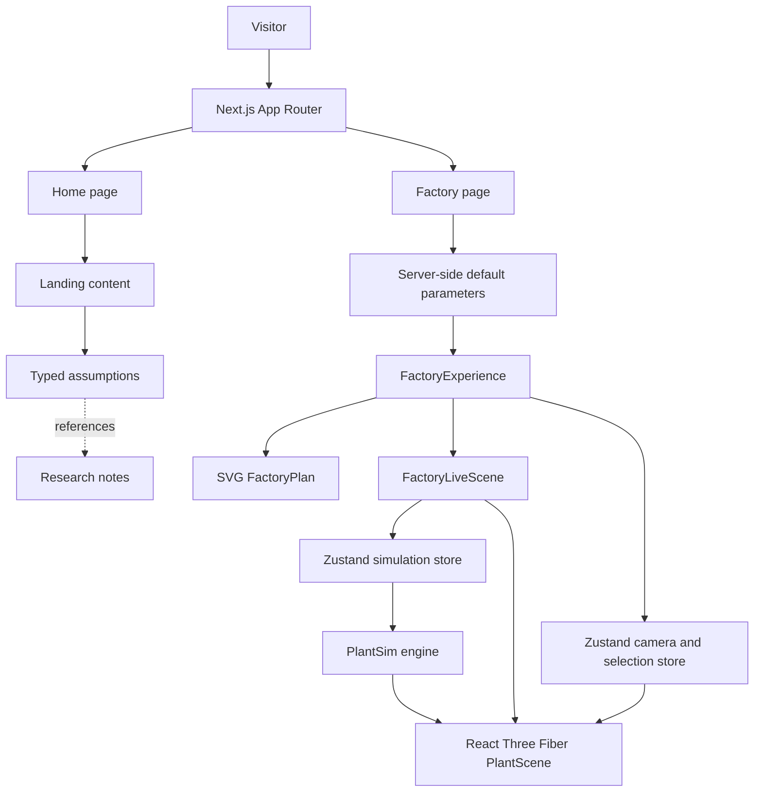
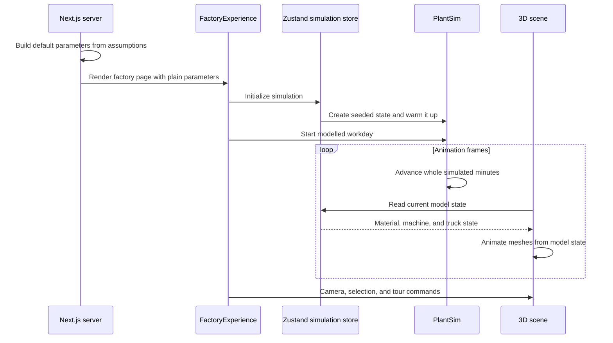

# Punarnava — Project Blueprint

> A beginner-to-advanced guide to the implementation in this repository. It explains the current application and identifies retained historical code separately.

**Evidence scope:** Source and documentation inspection on the current branch. No dependencies were installed; no lint, test, build, browser run, or deployment check was performed. Code-backed behavior is distinguished from illustrative modelling and unverified external claims.

For a concise project overview, start with the [README](README.md).

## Contents

- [Part I — Understand the project](#part-i-understand-the-project)
- [Part II — Architecture](#part-ii-architecture)
- [Part III — Implementation](#part-iii-implementation)
- [Part IV — Operate and extend](#part-iv-operate-and-extend)
- [Part V — Lessons and reference](#part-v-lessons-and-reference)

<a id="part-i-understand-the-project"></a>
# Part I — Understand the project

## 1. Executive overview

Punarnava is a concept-stage case study about a proposed Bengaluru plant that would turn post-consumer rigid plastic into recycled pellets. The repository contains a project presentation, an interactive factory concept, and a local simulation model that supplies a stylised animated workday.

It is not a recycling business in operation. There is no real plant, sensor feed, customer or supplier system, production ledger, or live financial data. The code models a possible process so a visitor can explore how the idea is structured.

The current application has [a presentation at /](src/app/page.tsx) and [a factory walkthrough at /factory](src/app/factory/page.tsx).

## 2. Problem, purpose, and intended audience

The concept explores a practical question: how could a small recycling operation receive used rigid plastic, sort and clean it, convert it into pellets, and keep material quality and movement understandable?

The application is intended to help a general visitor or reviewer follow that proposed process. The presentation explains the idea in plain language. The walkthrough gives the process a spatial form and lets a visitor move through its design choices. It is also a portfolio example of a data-driven React application with a separate TypeScript simulation engine and a WebGL renderer.

The research notes and numerical assumptions are planning material. They should not be read as a feasibility study, vendor quote, legal opinion, engineering design, or investment forecast.

## 3. What exists and what remains conceptual

| Present in the repository | Not implemented or not established |
|---|---|
| A responsive narrative page assembled from typed project content | An operating facility or tested industrial process |
| A guided, selectable presentation of proposed plant areas | A CAD/BIM drawing or engineer-approved layout |
| A seeded minute-step process model and a 3D scene driven by that model | Live machines, telemetry, real shipments, customers, or production records |
| A 2D SVG plan used as a fallback | Authentication, accounts, database, or user-submitted records |
| Research notes and an assumption catalogue | Complete clickable citations or independent verification of all claims |
| Unit-economics and finance model code retained in the source tree | A currently routed interactive finance or research dashboard |

Some older OS and lab components are still tracked in `src/components/`, `src/data/`, and `src/lib/`. They are not current routes. Earlier paths such as `/os` and `/sim` redirect to `/factory`; `/sources` is not an active route.

## 4. Beginner glossary

| Term | Meaning in this project |
|---|---|
| **HDPE** | High-density polyethylene, a common rigid plastic used in containers and crates. |
| **rHDPE** | Recycled HDPE. Here it is a proposed output, not a product currently made by a plant. |
| **Feedstock** | The used plastic entering the proposed process. |
| **Flake** | Small pieces produced when sorted plastic is cut or shredded. |
| **Pellet** | Small grains of processed plastic intended as manufacturing material. |
| **EPR** | Extended Producer Responsibility, a regulatory framework referenced by the project. Its legal details are not re-validated by this guide. |
| **Yield** | Saleable output divided by input, usually expressed as a percentage. |
| **Assumption** | A model input used because the project has no measured operating data. |
| **Seeded randomness** | Pseudo-random variation driven by a stored starting number. Reusing the seed and inputs reproduces the same model run. |
| **FIFO** | “First in, first out”: material that entered a buffer earlier is processed first. |
| **React component** | A reusable function that describes part of a page or interface. |
| **Route** | A URL path handled by the Next.js application. In the App Router, folders and page files define routes. |
| **WebGL** | A browser graphics interface used here to draw the interactive 3D plant. |
| **Zustand store** | A small shared state container. The simulation store holds the running model and UI state; a separate store controls the 3D camera and selection. |

<a id="part-ii-architecture"></a>
# Part II — Architecture

## 5. Verified technology stack

Versions are declared in `package.json`; this describes repository dependencies, not a fresh runtime verification.

| Technology | Role visible in the source |
|---|---|
| Next.js App Router | Routes, server-rendered page structure, metadata, and development/build commands |
| React and TypeScript | UI components, typed project data, and the process model |
| Tailwind CSS v4 | Utility styling and design tokens |
| Three.js, React Three Fiber, and Drei | The browser-rendered 3D factory scene and its controls |
| Zustand | Shared simulation and scene state |
| Vitest | Unit tests for the simulation, retained unit model, and retained finance code |
| Recharts | Present in dependencies and retained OS/lab chart components; not the visual foundation of the two current routes |

The main landing diagrams are drawn with React/SVG/CSS. The animated factory is the part that uses the 3D stack.

## 6. Current routes and page composition

| Path | Source | Behavior |
|---|---|---|
| `/` | `src/app/page.tsx` | Project narrative composed from landing-page sections |
| `/factory` | `src/app/factory/page.tsx` | Proposed plant, animated workday, area-by-area story, design logic, and build gates |
| `/os`, `/os/factory`, `/sim` | `next.config.ts` redirects | Redirect to `/factory`; they are not private applications |
| `/sources` | No active page file | Not a current route |
| `/robots.txt`, `/sitemap.xml`, icons, Open Graph image | Metadata route files under `src/app/` | Search/crawler and sharing metadata |

`src/app/sitemap.ts` lists the home and factory pages. `src/app/robots.ts` allows crawling. Repository configuration does not establish whether a live deployment exists or is functioning.

The factory experience includes:

- A 3D view on capable desktop browsers.
- An SVG plan view selected automatically on narrow screens or where WebGL is unavailable; visitors can also switch views on desktop.
- Selectable process stops, a story card, next/previous navigation, a guided cinematic tour, and free 3D exploration.
- A workday caption showing modelled time and phase.
- Error handling that falls back to the plan if the 3D scene fails to initialize.

The current factory page passes default parameters to the scene. Although the simulation store and engine contain scenario/event operations, the current public page does not expose the older slider/event/KPI dashboard controls.

## 7. Application architecture

The presentation builds its diagrams and copy from `src/data/landing.ts`, which reads from the assumption catalogue. The server-side factory page converts selected assumptions into a plain parameter object; the browser then runs the engine and draws that state.



### Factory interaction sequence



These diagrams show source-level flow; they do not imply connection to physical equipment or an external service.

## 8. Relevant folder and file map

```text
README.md                         Recruiter-facing project overview
PROJECT_BLUEPRINT.md              This technical and learning guide
DEMO.md                           Current demo guide plus preserved historical draft
CLAUDE.md                         Current-status notice plus preserved historical notes
docs/
  OPERATING_MANUAL.md             Current local-use guide plus old manual preserved below
  PUNARNAVA_FILM_SCRIPT.md        Current concept walkthrough plus old script preserved below
research/
  01-market.md                    Research note referenced as R1
  02-unit-economics.md            Research note referenced as R2
  03-competitors-investors.md     Research note referenced as R3
src/
  app/
    page.tsx                      Current home route
    factory/page.tsx              Current factory route
    layout.tsx                    Root layout, fonts, metadata, providers
    robots.ts                     Crawler rules
    sitemap.ts                    Current route list for crawlers
  components/
    landing/                      Home-page narrative sections and diagrams
    factory/                      Factory plan, experience, and workday caption
    sim/                          Simulation store, controls, and scene code
    sim/three/                    Three.js scene, models, layout, and animation
    layout/                       Shared page layout pieces
  data/
    assumptions.ts                Typed assumption catalogue and helpers
    landing.ts                    Home-page content and calculated summaries
    factory-story.ts              Story stops and camera shots
    os/, lab/                     Retained data for old, unrouted screens
  sim/
    engine.ts                     Pure TypeScript minute-step simulation
    params.ts                     Server-side assumption-to-parameter mapping
    types.ts                      Simulation inputs and state shapes
  lib/
    lab/                           Retained unit-economics and scenario logic
    data/                          Retained data accessors for old screens
archive/                           Earlier route/component source retained for history
package.json                       Scripts and dependency declarations
package-lock.json                  Locked npm dependency tree
next.config.ts                     Redirects, response headers, Next options
vercel.json                        Vercel framework declaration only
vitest.config.ts                   Test discovery and path aliases
.env.example                       Example configuration names
```

## 9. Main implementation pieces

### Presentation route

`src/app/page.tsx` composes the home page from `src/components/landing/`. Section text and derived presentation values live mainly in `src/data/landing.ts`. Figures are formatted and paired with short notes by components under `src/components/landing/figures/`.

The home page is not a separate backend product. Its charts are calculated or drawn in the application from local assumption data.

### Factory route

`src/app/factory/page.tsx` calls `defaultParams()` and passes the resulting `SimParams` to `FactoryExperience`. This keeps the assumption catalogue on the server-side parameter path rather than passing the entire catalogue into the browser.

`FactoryExperience` owns display state such as selected view, selected stop, tour, exploration mode, and fallback state. `FactoryPlan` draws a labelled SVG plan. `FactoryLiveScene` initializes and advances the simulation and mounts the 3D plant. `PlantScene` uses React Three Fiber’s `Canvas` and composes site and live entities from code-defined geometry.

The layout coordinates in `src/components/sim/three/site.ts` are stylised design coordinates. `models.tsx`, `prims.tsx`, and related files construct shapes in code; they do not load a surveyed site, CAD drawing, or vendor equipment model.

### Simulation store and scene store

`src/components/sim/sim-store.ts` wraps `PlantSim` in Zustand. It stores the model instance, input parameters, seed, playback speed, selection, and view state. The engine owns production state; the store notifies React when the engine advances.

`src/components/sim/three/camera-store.ts` holds scene state such as camera commands, selected area, tour step, and scene readiness. Keeping this separate prevents camera movement from becoming part of the process calculations.

<a id="part-iii-implementation"></a>
# Part III — Implementation

## 10. Assumption model and evidence

`src/data/assumptions.ts` is a typed catalogue. Each record has an identifier, label, numeric value, unit, category, source text, confidence, and status; some records also have notes, conflicts, a source URL, or an `ownerOnly` marker.

The catalogue helpers are:

- `getAssumption(id)` returns a typed record or throws if the ID is unknown.
- `v(id)` reads its numeric value.
- `num()` and `money()` format values using Indian-style grouping.
- `publicAssumptions()` filters records marked `ownerOnly`; this is an application data filter, **not repository access control**.

`src/sim/params.ts` imports `server-only` and maps only the inputs needed by the factory model into `SimParams`. The current public repository still contains the full source catalogue. The project owner has confirmed that the flagged business scenarios are illustrative case-study material; this guide does not reproduce their individual figures.

Status and confidence mean different things:

| Field | Meaning in this project |
|---|---|
| `placeholder` | A value still needs confirmation |
| `researched` | The value is recorded in research notes but has not been independently verified |
| `verified` | Intended for a value checked against a primary record such as a quote, agreement, or filing |
| `low`, `medium`, `high` confidence | The model author's confidence in the assumption; it is not the same as evidence status |

Research keys R1, R2, and R3 refer to the Markdown notes under `research/`. The assumption-file comments say clickable source links were not carried into those notes, and the current source records generally lack `sourceUrl`. A source label therefore does not itself let a reader independently reproduce or verify a claim.

## 11. Home-page calculations

The visible home-page economics are intentionally simple. In `src/data/landing.ts`, the per-kilogram margin is assembled from the catalogue:

```text
revenue per kg = pellet price per kg + EPR income per kg
cost per kg = feedstock + inbound transport + labour + electricity
              + overhead + rent + water/other
illustrative margin per kg = revenue per kg - cost per kg
```

The variables are planning inputs, not measured sales or expenses. A positive modelled margin does not establish commercial feasibility.

The landing page also:

- Reads the displayed annual-revenue and break-even figures directly from assumptions.
- Builds the cost breakdown from individual cost assumptions.
- Reads individual and combined stress-case results from stored assumptions; the active landing code does not re-run the financial model when a visitor changes those figures.
- Adds selected capital-cost and working-capital categories for an estimated start-cost illustration, then computes each displayed funding share as `category amount ÷ total amount`.

These formulas explain the implementation, not whether the selected assumptions are economically or legally sound.

## 12. Retained unit-economics calculator

`src/lib/lab/unit-model.ts` contains a more complete pure calculation module for the older `/lab` interface. That interface is not a current route, so the calculator is retained code rather than a feature a visitor can currently use.

The module calculates one modelled month:

```text
input kg = daily input capacity × 1,000 × operating days × utilisation
output kg = input kg × yield percentage
revenue = output kg × (pellet price + EPR price)
EBITDA = revenue - variable costs - fixed costs
```

Here, **EBITDA** is a simplified operating result before interest, tax, depreciation, and amortisation. Variable cost includes feedstock, inbound freight, energy, output-related costs, and the variable share of maintenance. Fixed cost includes labour, rent, overhead, demand charges, and the fixed share of maintenance.

The retained calculator derives:

- **Break-even utilisation** as fixed cost divided by full-capacity contribution (revenue less variable costs).
- **Working capital** from modelled receivables, raw-material stock, finished-goods stock, supplier payment delay, and a cash buffer.
- **Funding** as fixed capital expenditure plus deposit plus working capital.
- **Simple payback** as funding divided by annualised EBITDA when that result is positive. The code explicitly omits ramp-up, tax, and interest from this simple payback.

These are screening calculations. The formulas omit real-world complexity, and their output depends entirely on the inputs. The UI and formula tests for this module live under `src/lib/lab/`, but the current route set does not expose the calculator.

## 13. Illustrative factory simulation

### 13.1 State and material path

The simulation is implemented in `src/sim/engine.ts` without React or wall-clock dates. Time is an integer count of simulated minutes. Material moves through ordered buffers:

```text
bale yard → sorted → flakes → washed → silo → melt → QC hold
          → packing queue → finished goods
```

Each buffer holds FIFO `Parcel` records. A parcel contains its lot identifier, mass, and the minute it entered the buffer. This lets the model carry a truckload's identity through processing and associate later output with earlier input.

Each simulated minute, the engine:

1. At midnight, closes the previous day when needed and adds modelled supply for an operating day.
2. Expires ended events and settles cash movements whose due time has arrived.
3. Accrues fixed costs.
4. Processes units from downstream back toward sorting, then handles inbound and outbound truck activity.
5. Tracks lots, advances the simulated minute, and records an hourly sample when the hour boundary is reached.

The processing order is sorting, shredding, washing, drying, extrusion, pelletising, QC, and packing. `UNIT_DEFS` maps each unit to its input buffer and output buffer.

### 13.2 Capacity, losses, and yield

For a processing unit in a minute, the input quantity is bounded by three things:

```text
processed input = minimum of:
  unit capacity for one minute
  available upstream material
  downstream buffer space adjusted for expected loss
```

The model applies contamination rejects at sorting, then wash loss, then process loss. Base-case saleable yield is calculated as:

```text
base yield = 1 - (sorting loss + wash loss + process loss) / 100
```

The engine adjusts later-stage loss fractions so each stage's loss is applied to the material reaching that stage. This preserves the chosen total input-relative base losses. Those percentages remain assumptions until measured against real feedstock and a real process.

### 13.3 Time, scheduling, and seeded variation

`PlantSim.step()` advances one simulated minute; `run(n)` repeats that step `n` times. The engine uses a seeded Mulberry32-style generator stored in `SimState`, not `Math.random()`. The same seed and same parameters reproduce the same supply variation and breakdown sequence.

`sim-store.ts` starts with a fixed seed and warms the model before showing the workday, so the first frame has material in the process. In the current `FactoryLiveScene`, the displayed scene advances at a nominal 20 simulated minutes per real second. The frame loop caps large elapsed intervals, so backgrounding or browser throttling can change wall-clock pacing without changing the underlying minute-step rules.

The model includes a weekly operating schedule, shift schedule, truck arrival windows, buffer limits, and optional event types for breakdowns, supply dips, and price changes. The engine/store expose those operations, but the current factory page does not provide the older event and scenario control panel.

### 13.4 Money and KPI calculations

The engine maintains separate accumulated costs, booked revenue, cash, receivables, and payables. Dispatch books pellet and modelled EPR revenue; cash moves when the simulated due date is reached. Simulated profit and simulated cash therefore need not be identical at every minute.

Read-only KPI functions derive values from simulated state. Examples include:

- `yieldPct`: packed output relative to lot input, or a loss-based interim estimate before complete lots exist.
- `energyKwhPerT`: accumulated electricity divided by tonnes processed at sorting.
- `EBITDA`: booked model revenue minus accumulated model costs.
- Trailing price and cost per kg: recent sold revenue divided by sold mass, and recent costs divided by produced mass.

These KPIs are outputs of a hypothetical process, not historical operating performance.

### 13.5 What the 3D view represents

The factory view renders model state; it is not a second simulation. `src/components/sim/three/live.tsx` reads plant, truck, buffer, and unit state and updates meshes during React Three Fiber frames. Static geometry is assembled from code in `models.tsx`, `prims.tsx`, and `site.ts`.

`FactoryPlan` is a separate SVG interpretation of the same broad process story. It is a fallback and explainer, not a surveyed drawing. Neither representation should be used for construction, equipment sizing, safety approval, or permit applications.

## 14. Important flows, end to end

### Visitor opens the presentation

1. Next.js renders `src/app/page.tsx`.
2. The page composes section components from `src/components/landing/`.
3. Those components read structured copy and derived values from `src/data/landing.ts`.
4. `landing.ts` reads from `src/data/assumptions.ts`; diagrams render with React, SVG, and CSS.

### Visitor opens the factory

1. `src/app/factory/page.tsx` creates default `SimParams` on the server.
2. `FactoryExperience` checks WebGL and viewport size, then chooses an animated or plan view.
3. `FactoryLiveScene` creates or reuses the store's `PlantSim`, starts a requestAnimationFrame loop, and advances whole minutes.
4. The Three.js scene reads simulation state and animates code-generated geometry.
5. Selecting a stop changes the story card and asks the camera store to frame that area.

### Visitor starts the tour

The UI selects the first story stop, switches the scene into tour mode, and advances to later stops on a timer. Previous/next controls and pause/continue let the visitor move through the story. Leaving fullscreen mode returns camera controls to exploration mode.

<a id="part-iv-operate-and-extend"></a>
# Part IV — Operate and extend

## 15. Prerequisites and local setup

Use a compatible Node.js release and npm. This repository does not pin a Node or npm version. `package-lock.json` records the dependency tree.

From the repository root:

```bash
npm ci
npm run dev
```

Then open `http://localhost:3000`. The Windows helper `start-os.bat` also runs the dev server and opens the factory route after a short delay. For the clearest view of the animated scene, use a desktop browser with WebGL. The plan view is the intended fallback.

Optional environment values are listed in `.env.example`:

| Variable | Purpose in current source |
|---|---|
| `NEXT_PUBLIC_SITE_URL` | Optional public base URL used for metadata, robots, and sitemap output; otherwise the code falls back to the Vercel production URL or localhost. |
| `NEXT_PUBLIC_CONTACT_EMAIL` | Listed in the example file as a contact address, but no current source use or working contact form was found. Do not configure it expecting an email flow. |

Do not add real credentials to these variables. Values prefixed with `NEXT_PUBLIC_` are designed to be exposed to browser code.

## 16. Useful commands and tests

`package.json` defines:

| Command | Purpose |
|---|---|
| `npm run dev` | Start the local Next.js development server |
| `npm run lint` | Run ESLint |
| `npm test` | Run Vitest tests |
| `npm run build` | Build the Next.js application |
| `npm start` | Serve a previously built application |

Tests cover engine parameter wiring, mass and money balance, repeatability for seeded runs, model direction under changed inputs, and retained finance/unit-model calculations. Test names are in `src/sim/__tests__/engine.test.ts`, `src/lib/lab/__tests__/unit-model.test.ts`, and `src/data/os/__tests__/finance.test.ts`.

**Verification record for this documentation branch:** source files and scripts were inspected; no dependency installation, lint, test, build, browser run, or deployment check was performed.

## 17. Troubleshooting

| Symptom | What to check |
|---|---|
| `npm` is not recognized | Install Node.js with npm, open a new terminal, then confirm `node --version` and `npm --version`. |
| `npm ci` fails | Read the first npm error; check network access and lockfile consistency. Do not delete the lockfile as a first fix. |
| Port 3000 is already in use | Stop the other local server or open the port printed by Next.js. The Windows helper assumes the default port, so opening the printed address manually may be needed. |
| The 3D scene does not appear | Use a desktop browser with WebGL enabled. Wait for the fallback to appear or choose **Layout plan**. The scene also falls back after a rendering failure. |
| A font/build download fails | Next.js uses `next/font/google`; a restricted network can prevent the font download during a build. Retry on a permitted network or investigate local font hosting as a future improvement. |
| A guide sends you to `/os` | That is an old route. The current factory page is `/factory`; the configured redirect also lands there. |

## 18. Security, privacy, and deployment boundaries

- The current pages are public. There is no authentication or private-route system in the current source. Never treat old “local-only OS” wording as an access-control guarantee.
- `ownerOnly` is a model/UI marker. It does not make checked-in source private; this repository is public. The project owner has described the flagged business scenarios as illustrative case-study material.
- No current application API, database, user account, or contact submission path was found in the inspected application. The Open Graph image code fetches font assets from Google Fonts; no user-entered data is sent by that path.
- `robots.ts` permits crawling and the sitemap lists the home and factory routes. Do not deploy confidential material in this repository.
- `next.config.ts` sets response headers and redirects. Headers do not create authentication or turn public content private.
- `vercel.json` declares the Next.js framework; it does not prove a deployment exists. No hosted URL was verified for this documentation update. Check any prior Vercel link manually before sharing.

## 19. Known limitations and technical debt

1. **Evidence traceability:** assumption records name local research files, but the assumption-file comments say clickable source URLs were not retained. External claims need dated, direct sources and independent review.
2. **Model scope:** the simulation is an educational model of material flow and simplified money movement. It omits many engineering, plant, contract, quality, tax, financing, and regulatory details.
3. **Stylised design:** the plant layout is illustrative code geometry rather than CAD/BIM. Safety clearances and equipment specifications are not approved.
4. **Unrouted legacy code:** old OS/lab screens, data modules, and docs remain. They can confuse readers and may require maintenance if reconnected.
5. **No automated CI found:** tests are configured locally, but no repository workflow or Node version pin was found in the tracked files.
6. **Public contact configuration mismatch:** `.env.example` describes a contact email, but the current source does not implement that flow.
7. **No verified hosted demo:** repository configuration alone cannot establish that an old deployment URL remains live.

## 20. Practical extension opportunities

These are possible future improvements, not promises of work:

- Add a versioned evidence register with direct source URLs, publication dates, and notes on how each model input was derived.
- Add a visible assumptions/methodology page only after deciding its intended content and public scope.
- Add a scenario-control interface only if the project should expose the engine's existing scenario/event methods.
- Add lightweight CI that pins a Node version and runs lint, tests, and build.
- Capture and commit an accurate screenshot or short recording after checking the current UI in a browser.
- If the concept advances beyond a portfolio model, replace illustrative layout and inputs with qualified engineering, supplier, site, and operational evidence.

<a id="part-v-lessons-and-reference"></a>
# Part V — Lessons and reference

## 21. Engineering and product tradeoffs visible in the code

- **Separate calculation from presentation:** `src/sim/engine.ts` has no React dependency, which makes simulation rules easier to reason about and test independently from the 3D renderer.
- **Use seeded randomness:** model variation is repeatable, which helps debugging and comparison. It proves reproducibility of the code path, not validity of its assumptions.
- **Pair a rich view with a simpler fallback:** the WebGL scene is expressive, while the SVG plan remains usable on constrained devices.
- **Keep evidence next to claims:** the assumption catalogue gives each input a label, unit, source note, confidence, and status. Incomplete URLs limit how well an outside reader can audit it.
- **Show a proposal as a proposal:** the current page uses concept labels and caveats. Future copy should preserve that distinction instead of presenting model outputs as actual plant performance.

No personal motivation or first-person learning story is attributed here because the repository does not establish one. The project owner can add their own reflections after deciding which design and implementation choices they want to discuss.

## 22. Key source references

| Topic | Files |
|---|---|
| Current presentation and metadata | [Home page](src/app/page.tsx), [root layout](src/app/layout.tsx) |
| Current factory page and story | [Factory route](src/app/factory/page.tsx), [factory story stops](src/data/factory-story.ts) |
| Assumptions and landing calculations | [Assumption catalogue](src/data/assumptions.ts), [landing data](src/data/landing.ts) |
| Simulation types, parameters, and engine | [Simulation types](src/sim/types.ts), [parameter mapping](src/sim/params.ts), [engine](src/sim/engine.ts) |
| Browser stores and factory experience | [Simulation store](src/components/sim/sim-store.ts), [camera store](src/components/sim/three/camera-store.ts), [factory experience](src/components/factory/factory-experience.tsx) |
| 3D rendering and 2D fallback | [Plant scene](src/components/sim/three/plant-scene.tsx), [live scene objects](src/components/sim/three/live.tsx), [SVG plan](src/components/factory/factory-plan.tsx), [site coordinates](src/components/sim/three/site.ts) |
| Retained unit model and tests | [Unit model](src/lib/lab/unit-model.ts), [simulation tests](src/sim/__tests__/engine.test.ts), [unit model tests](src/lib/lab/__tests__/unit-model.test.ts) |
| Routes, deployment metadata, and commands | [Next config](next.config.ts), [robots](src/app/robots.ts), [sitemap](src/app/sitemap.ts), [package scripts](package.json) |

## 23. Questions for a future project-owner reflection

These are prompts, not claims about your experience:

- Which design choice best helped a first-time visitor understand the proposed process?
- Which simulation assumption would you want to validate first if the concept moved forward?
- What did you learn from keeping the process engine separate from the 3D scene?
- Which part of the project involved the most AI assistance, and how did you review that output?
