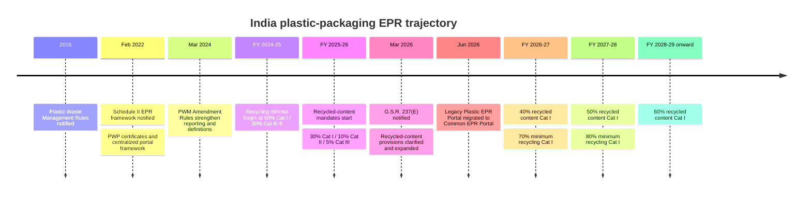
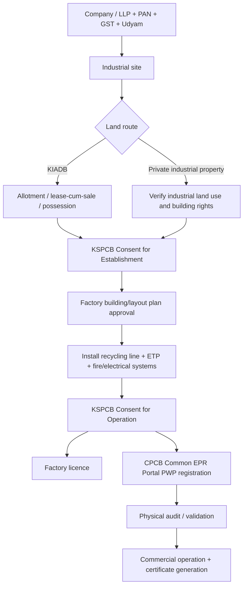

# Plastic Recycling in India and Karnataka in 2026: Strategic Assessment for Punarnava, Bengaluru

## Executive summary

India's plastic-recycling sector has moved decisively from a commodity-scrap business toward a **regulated circular-materials market**. The most important driver for Punarnava is the Extended Producer Responsibility framework for plastic packaging: the February 2022 EPR rules created mandatory recycling obligations and a certificate mechanism; the March 2024 amendments strengthened reporting and compliance; and the **Plastic Waste Management (Amendment) Rules, 2026, G.S.R. 237(E), notified on 31 March 2026**, sharpened recycled-content obligations and introduced additional mechanisms around recycled-content certificates. The old plastic EPR portal was discontinued from 28 June 2026 and migrated to CPCB's new Common EPR Portal. citeturn14view1turn12view0turn16search0

For FY2026-27, producers, importers and brand owners must ensure that at least **70% of their Category I rigid-plastic EPR target is recycled**, while the corresponding minimum is 50% for Categories II and III. More importantly for demand for secondary resin, mandatory recycled-content use in new packaging is now **40% for Category I rigid packaging, 10% for Category II flexible packaging and 5% for Category III multilayer packaging**. Category I rises to 50% in FY2027-28 and 60% from FY2028-29 onward. citeturn25view0turn25view1turn12view0

That combination strongly favors **high-quality recycled rigid polymers**, particularly PET and HDPE. By August 2026, the Government reported **65,241 registered PIBOs and 3,117 registered Plastic Waste Processors**, versus 3,012 processors in March, indicating continuing formalization. The Government also reported nearly 23.3 million tonnes of plastic-packaging waste recycled through the EPR system since the 2022 rules came into force. This cumulative portal number should **not** be divided by CPCB's annual waste-generation data to infer a recycling rate, because the two datasets have different reporting scopes and have not been reconciled publicly. citeturn24view0turn24view1turn25view2

Karnataka is a material feedstock state. Officially reported plastic-waste generation was 368,080 tonnes in FY2020-21, jumped to 528,031 tonnes in FY2021-22, and fell to 360,781 tonnes in FY2022-23, compared with 4.13 million, 3.90 million and 4.14 million tonnes nationally. The volatility is itself significant: it suggests measurement/reporting variation is large enough that investment decisions should be based on **contracted local feedstock studies rather than state waste statistics alone**. Karnataka represented about 10.4% of national reported waste on a three-year average using those years. citeturn27view0turn28view0

Current recovered-plastic pricing is fragmented rather than exchange-traded. As of October 2026, ScrapC quoted **PET bottles in Bengaluru at about ₹44/kg**; a South India baled-PET market report quoted ₹32.5/kg in June; and Scrapo's October all-India B2B median for sorted PET bottle loads was approximately ₹52.7/kg. For a Bengaluru recycler buying commercial volumes directly from MRFs and aggregators, **₹35-45/kg is therefore a more prudent PET-bale procurement budget than either household-kabadi rates or the national online median**. citeturn30search6turn30search18turn30search0

EPR certificates should be treated as **incremental revenue, not the reason a recycling plant is financially viable**. Public price discovery remains poor. A July 2025 market board showed only ₹1.00-1.50/kg for most plastic certificate categories, while 2026 market intermediaries have reported much wider ranges of roughly ₹3-20/kg, with several sources clustering around ₹4-18/kg. This dispersion is consistent with an OTC market differentiated by category, compliance year, urgency, seller quality and transaction size rather than a transparent CPCB-administered exchange price. citeturn33view7turn17search0turn17search4turn17search8

**Recommended first plant:** Punarnava should start with **clear post-consumer PET beverage bottles → sorted, hot-washed non-food-grade PET flakes**, rather than food-grade rPET pellets, mixed plastics, pyrolysis or flexible films. PET offers the best combination of recognizable feedstock, established collection economics, standardized mechanical recycling, measurable yields, deep downstream demand and direct exposure to Category I recycled-content mandates. Pelletization and ultimately food-grade bottle-to-bottle rPET should be a second-stage investment after Punarnava proves sourcing, wash quality, traceability and offtake. India's larger PET recyclers already operate substantial bottle-to-fiber chains, illustrating the depth of established downstream demand. citeturn30news30turn12view0

For a **500 kg/hour, two-shift PET wash-flake plant**, this report's base engineering model produces approximately 2,040 tonnes/year of input at 85% utilization and roughly 1,591 tonnes/year of PET flakes at a 78% yield. On a leased industrial site, a realistic preliminary fixed-CAPEX envelope is **₹2.2-2.8 crore**, plus roughly ₹1.1-1.5 crore of working capital. At ₹36/kg bottle feedstock, ₹65/kg flakes, ₹7.5/kg variable conversion cost, ₹0.70 crore annual fixed cash cost and only ₹2/kg of EPR value on 90% of eligible tonnage, modeled EBITDA is about **₹1.50 crore/year, or 13.5% of revenue**; without any EPR revenue it is about ₹1.13 crore, or 10.5%. The practical payback target should be **three to four years after allowing for ramp-up, financing, tax and working-capital friction**, notwithstanding a shorter steady-state simple payback.

| Investment conclusion for Punarnava | Assessment |
|---|---|
| Best first polymer | **Clear PET bottles** |
| Best first product | **Hot-washed, color-sorted PET flakes, non-food-contact** |
| Initial scale | **500 kg/h; 2,400 TPA nominal input** |
| Stabilized input | **~2,040 TPA** |
| Fixed CAPEX, leased site | **₹2.2-2.8 crore** |
| Working capital | **₹1.1-1.5 crore** |
| Core EBITDA without EPR | **~₹1.13 crore/year in base model** |
| EBITDA with conservative EPR assumption | **~₹1.50 crore/year** |
| Base EBITDA margin | **~10.5% material-only; ~13.5% including modeled certificates** |
| Practical payback | **~3-4 years including ramp-up/finance effects** |
| Critical pre-investment condition | Secure at least **60-70% of feedstock and 50-60% of flake offtake under written agreements** before ordering the wash line |
| Key strategic principle | **The material spread must support the plant even if EPR certificate revenue falls to zero.** |

## Regulation, EPR mandates and certificate economics

### The regulatory trajectory

India's present system is the product of several layers of regulation. The original Plastic Waste Management Rules were notified in 2016. The **Plastic Waste Management (Amendment) Rules, 2022**, notified on 16 February 2022, inserted the national EPR framework for plastic packaging and established the architecture under which PIBOs meet targets by obtaining certificates generated by registered Plastic Waste Processors. The Government reiterated these milestones in Parliament in March 2026. citeturn22view1turn24view0

The 2024 amendments added further reporting and regulatory provisions; in August 2026 the Government confirmed that the 14 March 2024 amendment requires urban local bodies and district-level Panchayats to file plastic-waste annual reports online by 30 June. A National Plastic Waste Reporting Portal was launched in June 2025. citeturn24view1

The latest material change is **G.S.R. 237(E), Plastic Waste Management (Amendment) Rules, 2026**, published on 31 March 2026. Among other changes, it updates Schedule II's recycled-content framework, introduces audit/verification requirements, clarifies food-contact exceptions and carry-forwards, and creates a distinct recycled-content certificate mechanism for certain PIBO obligations. citeturn10view0turn12view0

The recycling and recycled-content requirements are distinct. A PIBO can have a large EPR obligation, of which a specified minimum must be met through recycling rather than end-of-life treatment; it separately has to incorporate recycled polymer into new packaging according to the recycled-content schedule. citeturn25view0turn25view1turn12view0

| Compliance year | Cat I rigid: minimum recycling of EPR target | Cat II flexible | Cat III multilayer | Cat IV compostable: minimum recycling | Cat I mandatory recycled content | Cat II recycled content | Cat III recycled content |
|---|---:|---:|---:|---:|---:|---:|---:|
| FY2024-25 | 50% | 30% | 30% | 50% | — | — | — |
| FY2025-26 | 60% | 40% | 40% | 60% | 30% | 10% | 5% |
| **FY2026-27** | **70%** | **50%** | **50%** | **70%** | **40%** | **10%** | **5%** |
| FY2027-28 | 80% | 60% | 60% | 80% | 50% | 20% | 10% |
| FY2028-29 onward | 80% | 60% | 60% | 80% | **60%** | **20%** | **10%** |

**Sources:** the recycling minima were restated by MoEFCC in its March 2026 Lok Sabha reply; the recycled-content schedule comes from the March 2026 Gazette amendment. citeturn25view0turn25view1turn12view0

For Category III packaging, the recycled-content obligation is limited to the weight of the plastic layers. The 2026 rules also provide an exemption where the use of recycled plastic is prohibited by another applicable law, mandatory standard or regulator, including food/pharmaceutical/agrochemical contexts where relevant. For food-contact packaging affected in FY2025-26, a shortfall can under specified conditions be carried forward for up to three years beginning FY2026-27, with at least one-third of the carried obligation satisfied each year. citeturn12view0

The rules also contain reuse obligations for some Category I rigid containers. For packages from 0.9 to below 4.9 litres/kilograms, reuse targets rise from 10% in FY2025-26 to 25% from FY2028-29. Large drinking-water containers of at least 4.9 litres have much higher reuse targets. This matters because long-term rigid-packaging demand is being shaped simultaneously by **reduction/reuse, recycling and recycled-content mandates**; Punarnava should therefore not project virgin-like growth in every bottle segment. citeturn12view0

### How Punarnava would earn an EPR recycling certificate

A recycler becomes eligible only after registering as a Plastic Waste Processor. CPCB's PWP SOP requires information including the recycling process, pollution-control consents, plant capacity, geo-tagged plant photographs, electricity data, waste characterization and relevant authorizations. Fresh registration is valid for one year; renewal is for three years. CPCB's SOP states that an application should be processed within **15 days** and provides for a physical audit within **30 days after registration**; processing certificates become usable only after audit/validation. citeturn14view1turn15view1turn15view2

Certificates are generated category-wise against eligible plastic packaging processed by the registered PWP. CPCB's procedure links certificate generation to declared processing and to GST-linked data for recycled/processed material sold; certificates cannot be issued beyond the processor's registered installed capacity. PWPs must file their annual return by 30 June following the financial year. citeturn14view1

```mermaid
flowchart LR
    A[MRFs / aggregators / waste collectors] --> B[Punarnava receives segregated plastic]
    B --> C[Weighing + supplier traceability]
    C --> D[Sorting / washing / recycling]
    D --> E[Recycled flakes or pellets sold]
    D --> F[Processing data and records]
    E --> G[GST-linked sales evidence]
    F --> H[CPCB Common EPR Portal]
    G --> H
    H --> I[Audit / validation]
    I --> J[Category-wise EPR certificate generated]
    J --> K[Commercial price agreed OTC]
    K --> L[Certificate transferred on portal to obligated PIBO]
    L --> M[Commercial settlement]
```

For Punarnava, this means there are potentially **two outputs from one tonne of compliant recycling activity**: the physical recycled polymer and the regulatory certificate. They are economically separate, even though both depend on the same verified processing activity. The certificate should therefore be treated as a secondary monetization layer rather than substituted for good polymer economics. citeturn14view1turn27view0

There is an important 2026 distinction. The new rules also describe a **recycled-content certificate** mechanism under which an importer that cannot count recycled polymer already present in imported material may meet the obligation quantitatively by obtaining certificates from Producers, Importers or Brand Owners that have used recycled content above their own obligations. CPCB is to provide the centralized exchange mechanism. That is **not the same certificate as the PWP recycling certificate**. Punarnava, as a stand-alone recycler, directly creates the latter; it benefits from the former mainly through increased demand for its recycled resin unless it eventually becomes vertically integrated into packaging production. citeturn12view0

### Certificate prices and transaction structures

CPCB defines the compliance ledger and transfer mechanism but does not publish an official daily market-clearing price. Publicly visible pricing therefore comes from brokers, consultants and individual transactions rather than a regulated exchange. The divergence between price sources is substantial and should itself be viewed as a market risk. citeturn14view1turn33view7

| Public market reference | Date / period | Indicative rate | Interpretation |
|---|---|---:|---|
| Enviraj — recycling Cat I | 23 Jul 2025 | **₹1.10/kg** | Older benchmark; Cat II ₹1.05, Cat III ₹1.40, Cat IV ₹1.50 |
| Enviraj — EOL Cat I | 23 Jul 2025 | **₹1.05/kg** | End-of-life certificate, not mechanical-recycling economics |
| Seyecs market commentary | Apr 2026 | **₹4-20/kg** | Broad 2026 market range across categories/conditions |
| IncorpX market commentary | Aug 2026 | **₹3-15/kg** | Broad category-dependent range |
| National Recycling commentary | FY2025-26 / Sep 2026 report | **₹4-18/kg** | Reported FY2025-26 range; also reports quarter-end tightening |
| Bengaluru BSWML/Dalmia structure | 2025-26 | ~**₹2.5/kg gross bundled value** on plastic co-processed | Local EOL/RDF arrangement; includes waste-handling economics and is **not directly comparable** with a clean recycling certificate |

Sources for the public market observations are market intermediaries rather than regulators and should therefore be used as indicative intelligence, not executable quotes. citeturn33view7turn17search0turn17search4turn17search8turn17news32

The Bengaluru BSWML example is especially useful in showing transaction structure. Reports on the city's “plastic trash to cash” initiative describe non-recyclable plastic moving to cement co-processing with EPR-linked value; approximately ₹2,500/tonne of value was cited against roughly ₹1,500/tonne transport cost, leaving around ₹1,000/tonne net for BSWML. Because this is a bundled municipal-waste/co-processing arrangement, it should not be used as the pricing benchmark for Punarnava's Cat-I mechanical recycling certificates. citeturn17news30turn17news32

Three commercial structures are likely for Punarnava:

**Direct bilateral certificate sale** is the cleanest. Punarnava and a PIBO agree category, compliance period, quantity and ₹/kg consideration; after eligible tonnage has been validated, the certificate is transferred in the CPCB portal and commercial settlement follows the contract.

**Waste-processing plus certificate bundle** can reduce feedstock risk. A brand owner, PRO or collection partner may channel bottles to Punarnava under a processing arrangement, while the physical polymer is sold separately and the certificate is allocated to the obligated party. Commercial agreements need to state clearly who owns the recycled material, the certificate and any rejected fraction.

**Aggregator/broker model** gives smaller recyclers access to multiple PIBOs but introduces spread, settlement and counterparty risk. Because CPCB's ledger is the legal compliance mechanism, Punarnava should insist that every commercial transaction reconcile to actual portal transfer and not merely to a broker-issued statement. citeturn14view1turn15view0

For investment appraisal, this report uses only **₹2/kg on 90% of processed tonnage** as a management-case EPR value—below several public 2026 indications—and also calculates economics with **zero certificate revenue**. A bankable plant should survive the zero-credit case.

## Market size, Karnataka opportunity and 2026 price intelligence

### India and Karnataka market size

There is no single statistically consistent measure of India's “plastic recycling market.” CPCB/MoEFCC reports **plastic waste generated**, EPR portals report processed/recycled packaging tonnage, and commercial research houses estimate either recycling throughput or the value of recycled resins. These measures cannot safely be interchanged. citeturn24view0turn24view1turn29search1turn29search11

Government data show national plastic-waste generation of 4.127 million tonnes in FY2020-21, 3.902 million tonnes in FY2021-22 and 4.136 million tonnes in FY2022-23. Karnataka accounted for 368,080, 528,031 and 360,781 tonnes respectively. citeturn27view0turn28view0

For comparison, IMARC's 2026 commercial estimate places the **India recycled-plastics market at US$4.641 billion in 2026**, up from US$4.443 billion in 2025, and forecasts US$6.577 billion by 2034, a 4.45% CAGR. Its separate waste-plastic-recycling volume study estimates 11.92 million tonnes in 2025 and a 9.0% CAGR to 25.88 million tonnes in 2034. The latter volume is far above CPCB's official annual post-consumer waste-generation series, confirming that the commercial study is using a broader market definition; it should not be interpreted as CPCB-measured municipal/post-consumer waste recycled. citeturn29search11turn29search1

MarketsandMarkets provides a materially higher 2026 Indian recycled-plastics valuation of US$6.572 billion and US$11.708 billion by 2031. Its public page simultaneously states an 8.6% CAGR, although those two endpoints mathematically imply roughly 12.2%; because of that internal inconsistency, this report uses the lower, internally consistent IMARC trajectory as its base case. citeturn29search0

For Karnataka, no credible published 2026 state-level recycled-plastics market value was located. The table below therefore uses a transparent proxy: Karnataka receives **10.39% of the India value estimate**, equal to its average share of officially reported national plastic waste over FY2020-21 through FY2022-23. Historical 2021-24 values and the 2027-31 forecast are derived at IMARC's 4.45% CAGR. Rupee conversions use **₹90/US$ as a planning assumption**, not a claim about the daily FX rate.

| Year | India recycled-plastics market, base estimate | Karnataka planning estimate | Status |
|---|---:|---:|---|
| 2021 | US$3.73bn | US$0.39bn | Backcast |
| 2022 | US$3.90bn | US$0.41bn | Backcast |
| 2023 | US$4.07bn | US$0.42bn | Backcast |
| 2024 | US$4.25bn | US$0.44bn | Backcast |
| 2025 | **US$4.44bn** | ~US$0.46bn | India source year |
| **2026** | **US$4.64bn (~₹41,770cr)** | **~US$0.48bn (~₹4,340cr)** | India source year; Karnataka proxy |
| 2027 | US$4.85bn | US$0.50bn | Forecast |
| 2028 | US$5.06bn | US$0.53bn | Forecast |
| 2029 | US$5.29bn | US$0.55bn | Forecast |
| 2030 | US$5.52bn | US$0.57bn | Forecast |
| 2031 | **US$5.77bn (~₹51,930cr)** | **~US$0.60bn (~₹5,400cr)** | Five-year forecast |

**Methodology:** India 2025-26 anchor and 4.45% CAGR from IMARC; Karnataka share derived from MoEFCC/CPCB-reported waste generation; ₹90/US$ is a Punarnava modeling assumption. citeturn29search11turn27view0

Karnataka's official waste series should be treated as an **order-of-magnitude feedstock indicator**, not a bankable supply figure. The state reported 528,031 tonnes in FY2021-22 but only 360,781 tonnes the following year. At the same time, only nine SBM(G) Plastic Waste Management Units were reported operational in Karnataka as of 5 December 2024; those rural PWMUs are not equivalent to all commercial recyclers and should not be mistaken for the state's total recycling capacity. citeturn28view0turn28view1

Bengaluru itself is a substantial source market: Karnataka's Chief Minister stated in late 2025 that the city was generating about **900 tonnes of plastic waste per day**. This figure is useful as a local scale indicator but is a reported political/administrative statement rather than an audited polymer-specific material-flow study. citeturn29news39

### Bangalore spot prices: what can and cannot be known

There is **no recognized official Bengaluru commodity exchange for post-consumer plastic**. Online boards report asking prices, often mixing loose household material, baled feedstock, washed regrind and industrial scrap. Transaction prices can move by more than ₹10/kg based on color, moisture, PVC contamination, bale density, quantity, pickup terms and payment terms. Scrapo explicitly notes that its B2B prices apply to sorted loads and that loose mixed material purchased by a kabadiwala trades lower. citeturn30search4

The most defensible approach for Punarnava is therefore to separate **observed market quotes** from **procurement budgeting assumptions**.

| Material, Oct 2026 context | Publicly observed indication | Punarnava 2026 working range | Confidence / interpretation |
|---|---:|---:|---|
| **PET bottles, sorted/baled** | Bengaluru ₹44/kg on ScrapC; South India baled ₹32.5/kg in Jun; all-India sorted median ~₹52.7/kg | **₹35-45/kg** | **High-medium.** Best price transparency of the three streams. citeturn30search6turn30search18turn30search0 |
| **HDPE containers/bottles** | Bengaluru listings roughly ₹35-60/kg for bottle scrap; blue HDPE listings can reach ~₹70/kg; HDPE bottle grinding quoted around ₹42/kg; all-India sorted-HDPE median ~₹72/kg | **₹35-50/kg for sorted container feed; ₹45-70/kg for cleaner grind** | **Medium.** Strong dependence on natural vs colored material and whether quoted material is already ground/washed. citeturn30search19turn30search22turn30search1 |
| **PP rigid containers/crates** | Bengaluru's visible board is dominated by raffia at ~₹20-21/kg and jumbo bags ~₹37/kg, neither of which is equivalent to rigid PP; all-India sorted PP median ~₹59/kg | **₹30-50/kg for post-consumer rigid PP** | **Low-medium.** Budget range is an assumption because city boards do not cleanly separate rigid PP. citeturn30search8turn30search4 |
| **Washed PET flakes** | Bengaluru supplier listings commonly ~₹55-70/kg, with lower-grade quotes below this | **₹58-70/kg; base model ₹65/kg** | **Medium-high** for non-food-grade, clean flakes. citeturn30search10 |
| **Recycled HDPE granules** | Blue-drum recycled granule listing around ₹90/kg | **₹75-95/kg** | **Medium.** Natural high-quality grades can command materially more. citeturn30search19 |
| **Recycled PP pellets/granules** | Bengaluru B2B listings span widely; high-quality “natural” grades can be quoted as high as ₹135/kg | **₹70-95/kg for ordinary recycled grades; premium natural grades higher** | **Low-medium.** Quality dominates polymer label. citeturn30search16 |
| **rPET pellets** | Bengaluru/India supplier quotations are broad, roughly ₹90-150/kg depending on quality/application | **₹85-110/kg non-food / higher for qualifying premium grades** | **Low-medium.** Food-grade bottle-to-bottle resin can behave differently from ordinary PCR. |

The spread between virgin and recycled resin also requires caution. Current free-access industry sources show **October 2026 producer price revisions**—for example, PP domestic prices increased by ₹1,000/tonne at the start of October and various HDPE grades were rolled over or increased—but the full absolute producer-grade price tables are subscription products. citeturn33view5turn33view6turn30search9

Accordingly, the virgin values below are **Punarnava planning assumptions**, not claimed exchange closes:

| Polymer | Recycled product planning range | Virgin-resin planning benchmark* | Typical modeled recycled discount | Strategic observation |
|---|---:|---:|---:|---|
| PET | Flakes ₹58-70/kg; ordinary rPET pellet ~₹85-110/kg | **₹95-110/kg** | Flakes ~₹30-50/kg below resin; pellets can be near parity | Recycled-content mandates can compress the traditional rPET discount, especially for traceable high-quality resin |
| HDPE | Pellet ~₹75-95/kg | **₹105-120/kg** | ~₹15-40/kg | Natural/white PCR is much more valuable than mixed-color material |
| PP | Pellet ~₹70-95/kg | **₹100-115/kg** | ~₹10-35/kg | Grade variability and odor/impact-property issues make “PP” a much less fungible product than the name implies |

\*Model assumptions informed by current producer-pricing direction; Punarnava should replace them with three same-week Bangalore delivered quotes for the exact virgin grade before final investment approval. Current producer revision evidence is available from Plastemart and PolymerUpdate. citeturn33view6turn30search24

The most important commercial takeaway is that **a recycler does not earn the headline “virgin-minus-recycled” spread**. The recycler first loses mass through labels, contamination and moisture; then pays sorting, power, labor, detergent/caustic, wastewater treatment, drying, freight and working capital. Yield and contamination are therefore as important as ₹/kg feedstock.

## Business models, operating margins and economics

A well-designed recycler should not have only one revenue stream. Punarnava can build four layers of revenue while keeping the first plant operationally simple.

**Physical material sales should remain the core.** For a PET plant, this means clear hot-washed flakes sold to polyester fiber, sheet, strapping and later pellet/bottle-grade customers. India's established PET-recycling industry already consumes very large bottle volumes: recent reporting on RSWM, for example, describes FY2025 recycling of 43,250 tonnes of PET bottles into recycled polyester operations. citeturn30news30

**EPR certificates are the second layer.** They offer unusually high incremental margin because the recycling plant has already incurred most processing costs to produce the physical resin. But certificate prices are volatile, compliance-dependent and audit-dependent, so debt servicing should be based on material sales, not credits. citeturn14view1turn33view7

**By-products matter.** PET bottle caps and rings are generally polyolefins, while labels and separated colored PET can be sold into lower-value channels where quality permits. A disciplined operator should measure by-product revenue separately from PET-flake yield so that poor bottle sorting cannot be disguised as “by-product recovery.”

**Contract processing / closed-loop arrangements** can reduce commodity risk. Rather than taking full feedstock and output-price exposure, Punarnava can offer traceable processing to brands, beverage bottlers, collection organizations or recyclers needing regional capacity. The 2022 EPR framework explicitly envisages producer collection/segregation infrastructure and registered processors as the verified recycling endpoint. citeturn27view0

A fifth, later-stage model is **pelletization/compounding**. Turning clean flakes into controlled-IV rPET pellets or turning HDPE/PP regrind into compounded pellets increases sale value but introduces melt filtration, extrusion energy, quality testing, odor control and customer qualification. It should be added only after the wash line runs reliably.

A sixth stage is **food-grade rPET**, but that should not be Punarnava's first product. The 2026 rules explicitly recognize the interaction between recycled-content requirements and other mandatory standards and require food-contact packaging to comply with applicable food-safety marking and labeling rules. The quality system for bottle-to-bottle PET is therefore materially more demanding than that for fiber/strapping-grade flakes. citeturn10view0turn12view0

### Margin structure

There is no reliable public dataset that gives an industry-wide Indian mechanical-recycler EBITDA margin by polymer and quality grade. Punarnava should therefore budget from physical mass balance rather than use generic “recycling industry margin” claims.

For a wash-flake operation, a useful unit-economic identity is:

**EBITDA per kg of incoming waste = flake yield × flake price + by-product revenue + EPR value − waste purchase price − variable processing − fixed cost per kg**

That identity also exposes the central risk: a ₹5/kg deterioration in the feedstock/output spread can destroy most of a small recycler's EBITDA.

For planning purposes, reasonable **target**, rather than guaranteed market, bands are:

| Business model | Target stabilized EBITDA margin | Main margin driver |
|---|---:|---|
| Sorting/baling only | ~3-8% | Volume, logistics density and trading spread |
| PET wash → flakes | **~8-15%** | Bottle-to-flake spread and 75-80%+ good-flake yield |
| HDPE/PP wash → regrind | ~8-15% | Color/grade separation and contamination |
| Wash + pelletization/compounding | ~10-18% | Ability to sell certified, repeatable resin specifications |
| High-spec/closed-loop recycled resin | Potentially higher but capital intensive | Customer qualification, traceability, consistency |
| EPR-only “margin” | Not a valid stand-alone business metric | Certificate price is supplemental to actual compliant processing |

These are **Punarnava planning bands derived from the material-price observations above and engineering assumptions**, not published industry averages.

The most defensible business strategy is therefore to negotiate supply and offtake simultaneously: for example, formula-link bottle purchases to a published PET-flake or virgin-PET reference with a predetermined processing spread. That is materially safer than buying waste at fixed cash prices and selling flakes into a falling market.

## Karnataka approvals, land pathway and incentives

### Approval architecture

A mechanical recycling project in Karnataka is not “licensed” by one agency. It requires a sequence of corporate, land-use, pollution-control, factory and EPR approvals.

KSPCB currently routes **Consent for Establishment, Consent for Operation and waste authorizations through its XGN online system**, and its site maintains both the consent procedure and current category-specific service timelines. KSPCB also publishes a separate application route for units processing/recycling plastic waste. citeturn31search0turn31search3turn31search15

CPCB's EPR registration is additional to those state consents; it is what makes the plant a registered PWP capable of issuing EPR certificates. CPCB specifically requires supporting pollution-control consents and other plant documents in the PWP application. citeturn14view1

A practical sequencing plan is:

| Approval / registration | Agency | When required | Key issue for Punarnava | Timing |
|---|---|---|---|---|
| Entity incorporation, PAN | MCA / Income Tax | At project start | Pvt Ltd or LLP normally preferable for project finance and contracts | Typically days; project-planning assumption |
| **GST registration** | GST authorities | Before taxable commercial operations | Needed for regular B2B material invoicing and documentation | Generally days if documentation is clean |
| **Udyam/MSME registration** | Ministry of MSME | Early | Important for MSME schemes and Karnataka incentive claims | Online; normally rapid |
| Industrial land / compatible lease | **KIADB or private industrial-property route** | Before CFE | Avoid residential/agricultural land-conversion risk; verify recycling is permitted land use | **Allow 2-6 months** for KIADB/land diligence; planning estimate, not statutory SLA |
| **KSPCB Consent for Establishment** | KSPCB | **Before construction/installation** | Process flow, water balance, ETP, air/noise controls, site/land documents and investment details | KSPCB publishes category-specific timelines; **budget 45-90 days** until exact classification is confirmed. citeturn31search3turn31search15 |
| Factory building / machinery layout approval | Karnataka Dept. of Factories, Boilers, Industrial Safety & Health | Before constructing factory/layout | Apply through state factory-safety system under Karnataka Factories Rules | Project allowance ~30-60 days; official service available online. citeturn31search1turn31search16 |
| Building/fire approvals | KIADB/local authority/Fire Department, as applicable | Before occupancy | Depends on site, building size, storage/fire load | Allow ~30-60 days; site-specific |
| **KSPCB Consent for Operation** | KSPCB | **After installation, before production** | Inspection and proof that ETP/controls match CFE | Budget ~45-90 days pending exact category/SLA. citeturn31search3turn31search15 |
| Factory registration & licence | Dept. of Factories, Boilers, Industrial Safety & Health | Before operating qualifying factory | Worker numbers, power, plans, safety arrangements | Published service document states **maximum 60 working days**. citeturn31search10 |
| **Plastic Waste Processor registration** | CPCB Common EPR Portal / concerned SPCB workflow | Before generating EPR certificates | Capacity, process, GST details, CFE/CFO, photos, electricity, safety/PC measures | **15-day processing target; physical audit within 30 days; fresh registration 1 year, renewal 3 years.** citeturn14view1turn15view1turn15view2 |
| Hazardous-waste authorization | KSPCB | If applicable to ETP sludge, used oil or other scheduled waste | Do not assume every PET wash plant is exempt; classify all residues | Hazardous-waste rules provide up to **120 days** for grant after a complete application. citeturn31search19 |
| Power, water and wastewater connection | BESCOM/ESCOM, KIADB/local supplier | Before commissioning | Washing/drying line needs adequate sanctioned load; secure lawful water source | Site-specific |
| EPFO / ESIC / professional tax and labour compliance | Relevant authorities | Based on employment thresholds | Integrate with payroll before scale-up | Threshold-dependent |
| Annual PWP return | CPCB portal | Ongoing | Due by **30 June following FY**; maintain mass balance and sale records continuously | Annual statutory compliance. citeturn14view1 |

The indicated 45-90-day KSPCB allowances are **project-management estimates**, not a substitute for the category-specific current SLA on KSPCB's live timeline schedule. Punarnava should obtain written classification of the proposed exact process—sorting only, cold wash, hot wash, extrusion/pelletization, etc.—before freezing a commissioning schedule. citeturn31search3

For a leased, already-industrial shed with adequate power and water, a disciplined project can reasonably target **four to eight months from site commitment to compliant production**. A greenfield KIADB plot requiring building construction should be budgeted at roughly **eight to fifteen months**, subject to allotment and construction. These are planning ranges rather than legal SLAs.

### KIADB and site-selection strategy

The safest site strategy for a first Punarnava plant is **a compliant leased industrial shed in or immediately adjacent to a notified industrial estate**, rather than purchasing raw land. The Karnataka Industrial Policy's operative guidelines themselves treat KIADB/KSSIDC possession, lease/sale agreement and building-plan approval as formal project milestones. citeturn33view1

A typical KIADB sequence is project application → land consideration/allotment → acceptance/payment → lease-cum-sale/possession → building-plan and utility processes. Exact allotment timing depends strongly on industrial area and plot availability; it is therefore more sensible to compare **three ready industrial sheds with existing power/water access** against a KIADB greenfield plot before committing capital.

For Punarnava, transport economics argue for a location within the Bengaluru waste-shed but outside high-cost central Bengaluru real estate. More important than being inside BBMP is being close to MRFs/aggregators, highway access and reliable industrial utilities.

### Central and Karnataka financial incentives

The incentive landscape is useful but should not determine the project.

**Karnataka Industrial Policy 2025-30** is now the applicable state policy for qualifying new investments that did not crystallize under the previous policy. The operative guidelines state that manufacturing enterprises can qualify for the policy's package of incentives, with entitlement depending on enterprise class, location/zone and investment. Eligible MSMEs must generally commence production within three years of the relevant approval/project milestone and apply for capital/base subsidy within one year after commercial production. citeturn33view1

The policy's stamp-duty and electricity-tax benefits require or have required enabling Revenue/Energy notifications; the operative guidelines explicitly contain transitional provisions rather than treating every headline concession as automatically available. Punarnava should therefore obtain a **written incentive-eligibility calculation from the District Industries Centre before selecting the land**, especially because a Bengaluru-area location can receive materially different treatment from a less-developed zone. citeturn33view1

The Karnataka policy also states that eligible subsidy can extend to new investment in **effluent-treatment plants**, including in circumstances where the underlying industrial activity has limited incentive eligibility. This is particularly relevant for a bottle-washing line. The amount depends on the applicable policy schedule and should be confirmed at sanction rather than booked as project revenue. citeturn33view1

For an exporting MSME, the 2025-30 operative guidelines provide **50% reimbursement of eligible international/statutory certification charges, subject to a ₹5 lakh ceiling per entity**. That becomes more relevant if Punarnava later sells high-specification PCR to multinational buyers. citeturn33view1

At the central level, **PMEGP** provides margin-money subsidy of approximately **15-35%**, with manufacturing-project eligibility capped at **₹50 lakh**. Because the recommended Punarnava plant is substantially larger, PMEGP is not the natural financing vehicle for the full project; it could be relevant only to a much smaller pilot or qualifying microenterprise configuration. citeturn32search2turn32search6

The Ministry of MSME's **MSE GIFT** program supports MSEs accessing institutional finance at concessional rates for clean/green technology, while **MSE SPICE** under RAMP is explicitly aimed at circular-economy practices including reuse and recycling. Current eligibility and available budget should be checked at sanction because these are programmatic schemes rather than unconditional grants. citeturn32search3turn32search7turn32search19

**CGTMSE** is also relevant as a credit-risk tool: it enables qualifying micro and small enterprises to access collateral-free lending under its guarantee framework. It is a loan guarantee, not a capital subsidy, and should be described to lenders accordingly. citeturn32search10

Under **Swachh Bharat Mission (Grameen) Phase II**, the Government provides up to **₹16 lakh per block for a Plastic Waste Management Unit**. This is principally public/ULB/Panchayat waste-management infrastructure support rather than a direct grant to an ordinary private recycler, but it may matter if Punarnava pursues a PPP/feedstock partnership with rural local bodies. citeturn27view0turn23search4

| Incentive / financing instrument | Potential value to Punarnava | Important qualification |
|---|---|---|
| Karnataka Industrial Policy 2025-30 capital/base incentives | **Potentially material** | Rate depends on enterprise size, location/zone and approved investment; obtain DIC eligibility before land commitment. citeturn33view1 |
| Karnataka stamp-duty/electricity-tax concessions | **Potentially material** | Subject to enabling notifications/transitional rules. citeturn33view1 |
| Karnataka ETP-related support | **Directly relevant** | Exact subsidy depends on applicable schedule/sanction. citeturn33view1 |
| Karnataka export-certification reimbursement | 50%, maximum **₹5 lakh** | Relevant later for export/high-spec certification. citeturn33view1 |
| PMEGP | 15-35% margin-money subsidy | Only projects up to **₹50 lakh manufacturing cost**; too small for recommended full plant. citeturn32search2turn32search6 |
| MSE GIFT | Concessional green financing | Eligibility/terms to be checked at application. citeturn32search3 |
| MSE SPICE / RAMP | Circular-economy support | Relevant to recycling MSME; current sanction structure should be checked. citeturn32search7turn32search19 |
| CGTMSE | Collateral-free credit guarantee | Financing facilitation, **not subsidy**. citeturn32search10 |
| SBM(G) PWMU support | Up to ₹16 lakh/block | Primarily government/local-body infrastructure; useful through partnerships, not assumed as direct Punarnava subsidy. citeturn27view0 |

## Principal risks and mitigation

Punarnava's highest risks are not technology risks. Mechanical PET recycling is established technology. The major risks are **commercial spread, feedstock quality, regulatory traceability and working capital**.

| Risk | Probability | Impact | Why it matters in 2026 | Recommended mitigation |
|---|---|---|---|---|
| **Feedstock shortage / bidding war** | High | Very high | EPR and recycled-content mandates are increasing demand for good PET/HDPE feedstock; large recyclers already consume very substantial PET volumes. citeturn30news30turn12view0 | Contract ≥60-70% of first-year supply before capex; diversify MRFs, scrap dealers, institutions and deposit/collection programs; use price formulas rather than fixed annual prices. |
| **Waste-price rise without flake-price rise** | High | Very high | PET Bengaluru indications already span roughly ₹33-53/kg depending on quality/market source. citeturn30search6turn30search18turn30search0 | Maintain minimum conversion-spread clauses; buy to quality specification; daily contribution-margin dashboard. |
| **Recycled resin price collapse / cheap virgin polymer** | Medium-high | Very high | Virgin producer prices remain volatile and directly influence recycled polymer economics. citeturn33view6 | Mix formula-linked offtake and fixed-volume contracts; diversify fiber, sheet and strapping customers; avoid a single buyer. |
| **EPR certificate price collapse** | High | Medium-high | Public indications range from ~₹1/kg historically to ₹3-20/kg during 2026, indicating weak price discovery. citeturn33view7turn17search0turn17search4 | Finance plant on zero-EPR case; sell certificates periodically rather than speculating; contract several PIBOs. |
| **Certificate invalidation / audit failure** | Medium | Very high | PWP certificates depend on registration, declared capacity, audit and validated records. citeturn14view1turn15view2 | Digital weighbridge integration; supplier KYC; batch IDs; GST invoice reconciliation; daily mass balance; independent quarterly compliance audit. |
| **PVC/foreign-polymer contamination in PET** | High | High | Small contamination can downgrade PET output and yield; PET economics depend heavily on salable flake yield. | Supplier bale specifications, pre-sort, label/color separation, hot-wash QC and eventually optical/NIR sorting at larger scale. |
| **Wastewater, wash fines and microplastic release** | Medium | Very high | Washing creates solids and polluted process water subject to KSPCB control. | Proper ETP, solids capture, water recirculation, sludge classification, routine COD/TSS monitoring and closed drains; design environmental controls before CFE, not after commissioning. |
| **Fire and stockpile loss** | Medium | Very high | Baled plastic has high combustible loading; feedstock inventories can become large because purchases are opportunistic. | Fire-rated storage compartments, aisle/stack-height controls, hydrants/sprinklers as applicable, thermal/CCTV monitoring, insurance and capped days of inventory. |
| **Working-capital squeeze** | High | High | Waste suppliers often expect fast payment while industrial customers pay later; EPR monetization can lag processing/audit. | Cash-credit line before commissioning; cap receivable days; supplier credit where possible; do not finance speculative bottle inventory. |
| **Regulatory or portal changes** | Medium | High | The old EPR portal was already replaced by the Common EPR Portal in June 2026, and rules were amended in March 2026. citeturn16search0turn12view0 | Dedicated compliance owner; monthly CPCB/KSPCB regulatory review; API-ready/digital records; avoid processes dependent on regulatory loopholes. |

Two sensitivities dominate the proposed PET project's economics. At 2,040 tonnes/year, a **₹5/kg increase in bottle purchase price reduces annual EBITDA by approximately ₹1.02 crore**. A **₹5/kg fall in flake selling price reduces EBITDA by roughly ₹0.80 crore** at a 78% yield. If both occur simultaneously, the base-case EBITDA is effectively wiped out. That is why a recycling business with superficially attractive ₹/kg selling prices can fail despite running at high utilization.

Similarly, a reduction of PET-flake yield from 78% to 72%, with all else constant, costs roughly ₹0.80 crore of annual sales at a ₹65/kg flake price. **Yield discipline is therefore a board-level financial KPI, not simply a production KPI.**

## Recommended first plant and investment case

### Why PET should come before HDPE or PP

For Punarnava's first plant, the optimal sequence is:

**Phase one: clear PET bottle → hot-washed flake.**

**Phase two: add controlled pelletization and/or higher-grade PET sorting once utilization and customers are proven.**

**Phase three: evaluate food-grade bottle-to-bottle rPET or a separate HDPE rigid line.**

PET wins the first-plant decision for five reasons.

First, PET beverage bottles sit in **Category I rigid plastic packaging**, the category with the strongest combination of recycling and recycled-content obligations. In FY2026-27, the recycling minimum is 70% of EPR target and recycled-content use is 40%, rising to 80% recycling and 50% recycled content in FY2027-28, then 60% recycled content from FY2028-29. citeturn25view0turn25view1turn12view0

Second, PET has better public feedstock price visibility than rigid PP and a more standardized post-consumer stream. Bengaluru bottle prices can be triangulated from a city quote, a South India bale benchmark and national B2B indices. citeturn30search6turn30search18turn30search0

Third, a flake-only plant avoids the additional capital, melt filtration, intrinsic-viscosity management and customer qualification required for PET pelletization. It therefore lets Punarnava learn the difficult part of the business—**feedstock procurement, mass balance, washing, contamination and compliance—before adding product complexity**.

Fourth, the downstream market is already industrialized. PET bottle recycling feeds polyester fiber, yarn, strapping, sheet and increasingly bottle-to-bottle applications; large Indian recyclers process tens of thousands of tonnes annually. citeturn30news30

Fifth, the process produces a useful additional polyolefin stream from caps/rings that can be sold rather than treated purely as waste.

HDPE containers are a credible **second choice**. High-quality natural HDPE can command strong recycled-resin prices, but detergent, chemical and lubricant residues, color variation and blow-molding/injection-grade differences make incoming quality more heterogeneous. Current Bengaluru-region quotes similarly vary substantially between bottle scrap, blue-drum material, grinding and granules. citeturn30search19turn30search22

PP rigid should follow later. The underlying market is large, but 2026 Bengaluru price boards do not cleanly distinguish rigid PP from raffia, sacks and jumbo bags, making feedstock economics less transparent for a first-time operator. citeturn30search8turn30search4

Mixed flexible plastics and pyrolysis should **not** be the first plant. They introduce lower-quality feedstocks, more difficult product sales, more complex emissions/process control and a business case that is much more dependent on policy/EOL economics.

### Recommended technical configuration

The recommended first facility is a **500 kg/hour clear-PET bottle wash line** operating two eight-hour shifts for approximately 300 days/year. The line should include bale opening, manual pre-sort, label removal, size reduction, sink-float separation, hot washing, friction washing/rinsing, drying, flake sorting, metal removal, finished-goods packing, cap/polyolefin recovery and a properly engineered wastewater-treatment/recycling system.

Full food-grade decontamination/extrusion should be deliberately omitted from phase one.

The project should be designed from day one for **traceability**: supplier ID, incoming gross/net weight, PET color/grade, batch number, process date, output flake weight, cap/label/reject weight, wastewater/sludge record, invoice number and EPR-certificate linkage. This makes CPCB compliance easier and also turns yield losses into measurable operating problems. CPCB's PWP framework explicitly relies on processing records, capacity, GST-linked sales information and audit. citeturn14view1

### Base-case unit economics

The following is a **Punarnava engineering-and-market model**, not a vendor quotation. Machinery-market listings in 2026 show individual recycling machines around ₹18-20 lakh, extrusion machines ₹20-25 lakh, crushers ₹3-6 lakh, shredders ₹3-14 lakh and balers ₹7-15 lakh; a complete PET line requires substantially more once washing/drying, sorting, ETP, electricals, civil works, material handling and commissioning are included. citeturn30search7

| Variable | Base assumption |
|---|---:|
| Nominal line rate | **500 kg/hour input** |
| Shifts | **2 × 8 h/day** |
| Operating days | **300/year** |
| Nameplate input | **2,400 TPA** |
| Stabilized utilization | **85%** |
| Stabilized bottle input | **2,040 TPA** |
| Good PET-flake yield | **78%** |
| PET flake output | **1,591 TPA** |
| Saleable cap/other polyolefin by-product | **8% / ~163 TPA** |
| Rejects/moisture/labels/etc. | **~14%** |
| PET bottle purchase price | **₹36/kg** |
| PET flake selling price | **₹65/kg** |
| By-product price | **₹22/kg** |
| Variable processing cost | **₹7.5/kg of input** |
| Annual fixed cash OPEX | **₹0.70 crore** |
| EPR management-case price | **₹2/kg** |
| EPR-eligible/monetized volume | **90% of input** |
| Base EPR value per kg of total input | **₹1.80/kg** |

The ₹36/kg feedstock assumption lies inside the current Bengaluru/South India PET-bale observations, and ₹65/kg is within current Bengaluru washed-flake listings. The ₹2/kg EPR assumption is deliberately below several publicly quoted 2026 ranges. citeturn30search6turn30search18turn30search10turn17search0turn17search4

| Annual economics at stabilized utilization | Base case |
|---|---:|
| Material revenue — flakes + by-products | **₹10.70 crore** |
| Conservative EPR revenue | **₹0.37 crore** |
| **Total modeled revenue** | **₹11.07 crore** |
| Feedstock cost | **₹7.34 crore** |
| Variable conversion cost | **₹1.53 crore** |
| Fixed cash operating cost | **₹0.70 crore** |
| **Total cash OPEX** | **₹9.57 crore** |
| **EBITDA including modeled EPR** | **₹1.50 crore** |
| EBITDA margin incl. EPR | **13.5%** |
| **EBITDA with zero EPR revenue** | **₹1.13 crore** |
| Material-only EBITDA margin | **~10.5%** |
| Cash cost per kg of incoming bottle | **~₹46.9/kg** |
| Net break-even flake price incl. modeled EPR | **~₹55.6/kg** |
| Net break-even flake price with zero EPR | **~₹57.9/kg** |

The modeled break-even throughput is approximately **651 tonnes/year, or 27% of nameplate**, with the conservative certificate assumption; it rises to about **781 tonnes/year, or 33% of nameplate**, with zero EPR revenue. In practice, a plant should not be considered healthy merely because it crosses accounting break-even at low utilization: procurement, quality consistency and customer qualification typically improve materially only at much higher throughput.

### CAPEX, working capital and payback

| Project-cost item | Planning range |
|---|---:|
| PET sorting/wash/dry line and auxiliaries | ₹0.70-0.95 crore |
| ETP, water recirculation and process-water systems | ₹0.20-0.35 crore |
| Electrical system, transformer/panels, compressors/utilities | ₹0.15-0.25 crore |
| Baler, forklift/material handling, laboratory/QC | ₹0.15-0.25 crore |
| Leased-shed civil adaptation, drainage, fire/safety | ₹0.20-0.35 crore |
| Installation, engineering, pre-operative expense and contingency | ₹0.20-0.30 crore |
| **Fixed CAPEX excluding land purchase** | **₹2.2-2.8 crore; base ~₹2.5 crore** |
| Working capital | **₹1.1-1.5 crore** |
| **Total funding envelope** | **~₹3.3-4.3 crore** |

These are 2026 planning estimates and should be replaced by at least three turnkey equipment bids plus a separate ETP quotation before financial close.

At ₹1.50 crore stabilized EBITDA, simple fixed-asset payback on a ₹2.5 crore plant is around **1.7 years**, while payback on total funds including working capital is around 2.5 years. Those figures are **not realistic commissioning-to-cash paybacks**, because they assume immediate stabilized utilization and exclude debt interest, tax, depreciation, early operating losses and working-capital ramp. Punarnava should underwrite the project to a **three-to-four-year practical payback** and test a downside case of four to five years.

The downside sensitivity is more important than the headline payback:

| Change from base case | Approximate annual EBITDA effect |
|---|---:|
| Bottle feedstock **+₹5/kg** | **−₹1.02 crore** |
| PET flakes **−₹5/kg** | **−₹0.80 crore** |
| EPR certificate revenue goes to zero | **−₹0.37 crore** |
| PET good-flake yield falls 78% → 72% | **−~₹0.80 crore revenue** |
| Feedstock +₹5/kg **and** flakes −₹5/kg | **~₹1.82 crore adverse effect; plant moves into loss** |

That sensitivity determines the correct go/no-go test. Punarnava should not order machinery until it has performed at least a **six-to-eight-week live procurement trial** in Bengaluru, physically bought representative PET bales, measured contamination/moisture/color composition, and validated the achievable hot-wash yield with a toll recycler or equipment vendor.

The strongest investment structure would therefore be:

**Feedstock:** contracted sources for at least 1,300-1,500 tonnes/year before commissioning, leaving the remainder to spot procurement.

**Offtake:** two or more flake buyers with combined indications covering at least 800-1,000 tonnes/year and defined quality parameters.

**EPR:** at least two PIBO/PRO/broker relationships, but **no certificate revenue included in bank debt-service coverage**.

**Site:** leased industrial shed with adequate sanctioned power, lawful water access and space for an ETP, preferably inside a notified industrial area.

**Expansion trigger:** install pelletization only after the wash line has achieved at least 75% utilization, ≥77-78% good-flake yield and six months of repeat customer acceptance.

On those conditions, **PET hot-washed flakes are the most defensible first manufacturing product for Punarnava in Bengaluru in 2026**. The policy tailwind is unusually strong, but the project's success will still be determined primarily by the old-fashioned recycler disciplines of buying clean feedstock, protecting yield, controlling water and energy, maintaining audit-grade traceability, and selling a consistently specified polymer.

navlistRecent market developments relevant to Punarnavaturn29news40,turn29news39,turn17news30,turn30news30