# Punarnava Plastic Recycling Plant, Bengaluru: Comparative Unit-Economics Report

## Executive summary

For Punarnava, the best risk-adjusted starting point is a **~5 tonne/day post-consumer rigid HDPE recycling plant producing non-food-grade recycled HDPE pellets**. The ~1 tonne/day configuration works as a pilot, sorting hub, or specialty-grade operation, but is structurally burdened by labour, rent, quality-control and compliance costs; in the base case it earns only about **₹2.99/kg of saleable output at EBITDA level**, is slightly EBIT-negative after illustrative depreciation, and has an all-in simple payback of roughly **14 years**. The ~5 tonne/day case improves to about **₹14.90/kg EBITDA margin**, while ~10 tonne/day reaches **₹18.46/kg** because fixed labour, rent, quality assurance, maintenance and administration are spread over substantially more saleable material.

The recommendation of **rigid HDPE rather than PET or LDPE film** is an analytical inference rather than a regulatory requirement. Bengaluru has a very large available plastic-waste pool: BSWML says the city currently generates about 5,500 tonnes/day of municipal waste; its CEO separately estimated around 500 tonnes/day of plastic waste, while the Chief Minister cited about 900 tonnes/day, showing both the scale and the uncertainty in composition. Flexible packaging dominates Indian consumer packaging but has materially poorer collection/recycling economics because much of it is multilayer or low-value. At the same time, Bengaluru/India listings show established markets for reprocessed HDPE, including black pellets around ₹85–90/kg and natural blow-grade material around ₹98/kg. citeturn25search7turn25search13turn25news29turn25search17turn24search17turn24search2

The base case deliberately uses a **blended realised pellet price of ₹82/kg**, below several Bengaluru asking prices, and **₹38/kg ex-source for sorted mixed-colour rigid HDPE scrap**, above a ₹30/kg HDPE-bottle-scrap listing. This creates room for quality discounts on output and competition for good feedstock. Recent Bengaluru recycled-HDPE listings span a very wide range—TradeIndia shows multiple reprocessed grades from roughly ₹70/kg upward, A.R. Enterprises quotes black reprocessed HDPE at ₹85–90/kg, and Plastic4Trade showed natural blow-grade material at ₹98/kg in July 2026—so the actual *spread between contracted feed and contracted output*, rather than either headline price alone, will determine Punarnava's return. citeturn24search0turn24search17turn24search2turn24search7

**Base-case conclusion as of October 13, 2026:**

| Metric | ~1 t/day | ~5 t/day | ~10 t/day |
|---|---:|---:|---:|
| Input throughput, t/month | 26 | 130 | 260 |
| Saleable pellet output, t/month | 20.28 | 104.0 | 213.2 |
| Yield | 78% | 80% | 82% |
| Fixed project CAPEX, excl. GST/land/WC | **₹0.765 cr** | **₹1.795 cr** | **₹2.970 cr** |
| Working capital | ₹17.2 L | ₹83.4 L | ₹168.5 L |
| Refundable lease deposit | ₹7.6 L | ₹16.8 L | ₹28.8 L |
| Total initial funding envelope | **₹1.01 cr** | **₹2.80 cr** | **₹4.94 cr** |
| Cash OPEX / kg output | ₹80.11 | ₹68.20 | ₹64.64 |
| Pellet realisation | ₹82.00/kg | ₹82.00/kg | ₹82.00/kg |
| Modelled EPR income | ₹1.10/kg | ₹1.10/kg | ₹1.10/kg |
| EBITDA margin | **₹2.99/kg** | **₹14.90/kg** | **₹18.46/kg** |
| Monthly EBITDA | ₹0.61 L | ₹15.49 L | ₹39.35 L |
| Annual EBITDA | ₹7.3 L | ₹1.86 cr | ₹4.72 cr |
| Breakeven input throughput | 0.88 t/day | 2.20 t/day | 3.53 t/day |
| Breakeven utilisation | 88% | 44% | 35% |
| All-in simple payback | **13.9 y** | **1.50 y** | **1.05 y** |
| Modelled seven-year pre-tax project IRR | **negative** | **~46%** | **~69%** |
| Investment view | Pilot only | **Recommended** | Attractive after supply/offtake proof |

The very high steady-state returns at 5–10 tonnes/day should **not** be interpreted as guaranteed project returns. They depend on maintaining a ₹38/kg feed purchase price, ~80%+ saleable yield, ₹82/kg pellet realisation, steady utilisation and rapid receivable collection. The combined stress case of **feed +20%, yield −5 percentage points and selling price −10%** drives EBITDA margin to approximately **−₹7.85/kg at 5 tonnes/day and −₹3.69/kg at 10 tonnes/day**. The investment proposition is therefore fundamentally a *procurement-and-offtake business with a recycling plant in the middle*, not simply a machinery investment.

## Feedstock choice and model assumptions

### Why rigid post-consumer HDPE

Punarnava should initially buy **pre-sorted or semi-sorted rigid HDPE packaging**, principally household and FMCG containers such as detergent, personal-care and home-care bottles, jars, cans and similar blow-moulded articles. Chemical/pesticide drums or other potentially hazardous containers should be excluded from the standard procurement specification unless Punarnava develops a separate, legally compliant decontamination protocol. The target product should be **non-food-contact PCR HDPE pellets**, separated into natural/light and coloured/black grades wherever volumes justify it.

This is attractive in Bengaluru for four reasons. First, the city has a large dry-waste and plastic-waste stream. Second, the current Indian recycling base is deep in polyolefins—an India Plastics Pact landscape assessment identified PE/HDPE/LDPE/PP recyclers as the largest resin group among surveyed recycling units. Third, the market for rigid HDPE recyclate is demonstrably active. Fourth, flexible plastics are more problematic: the India Plastics Pact notes that roughly 70% of consumer packaging is flexible, but much multilayer/flexible material remains poorly collected and recycled because of complex structures, low unit weight and weaker end markets. citeturn25search2turn25search17

PET can be an excellent recycling business, but it is a different business: bottle colour, PVC, labels/adhesives and hot-wash quality become critical, and high-value bottle-to-bottle applications raise the quality-control bar substantially. LDPE film is less suitable for Punarnava's first plant because dirty film generally requires much more washing and drying per saleable tonne. A current equipment guide, for example, contrasts materially higher water demand for film with rigid-plastic lines, while rigid-HDPE vendors routinely configure lines around crushing, float washing, dewatering and pelletising. citeturn23search12turn23search16

### Commercial and operating assumptions

All economics below are **Punarnava planning assumptions**, not vendor guarantees or market quotations.

| Base assumption | ~1 t/day | ~5 t/day | ~10 t/day |
|---|---:|---:|---:|
| Operating days/month | 26 | 26 | 26 |
| Input/day | 1,000 kg | 5,000 kg | 10,000 kg |
| Input/month | 26,000 kg | 130,000 kg | 260,000 kg |
| Saleable yield | 78% | 80% | 82% |
| Saleable output/month | 20,280 kg | 104,000 kg | 213,200 kg |
| Feedstock purchase, ex-source | ₹38/kg input | ₹38 | ₹38 |
| Inbound collection/freight | ₹2.50/kg input | ₹2.50 | ₹2.50 |
| Pellet selling price, ex-GST | ₹82/kg output | ₹82 | ₹82 |
| EPR certificate income in base case | ₹1.10/kg eligible output | ₹1.10 | ₹1.10 |
| Outbound product freight | ₹0.75/kg output | ₹0.75 | ₹0.75 |
| Product mix | Mixed colour + limited natural | More batch segregation | Stronger batch segregation |

The ₹82/kg output assumption sits below current Bengaluru quotes of ₹85–90/kg for black reprocessed HDPE and ₹98/kg for natural blow-grade material, while October 2026 national market data also show substantial dispersion by MFI, colour and grade. Virgin HDPE prices and producer revisions continue to move: Plastemart reported an October 10, 2026 increase of ₹3/kg for HDPE pipe grades while other HDPE sectors rolled over, underscoring the commodity-price exposure of recyclate. citeturn24search17turn24search2turn24search26turn24search13turn24search16

The EPR assumption is intentionally modest. CPCB's old plastics EPR portal was discontinued on June 28, 2026 and its data migrated to the new Common EPR Portal; registered processors therefore need current portal registration and transaction discipline. Indicative certificate quotations are extremely inconsistent: one market tracker showed Category-I recycling credits around ₹1.10/kg, whereas a 2026 compliance-market source quotes several times that amount. Bengaluru's own low-value-plastic co-processing programme has been earning about ₹1,000/tonne net after transport, although that is a different end-of-life route and should not be equated directly with HDPE recycling credits. Punarnava therefore should **not underwrite the project on EPR income above ₹1.10/kg**, and a lender case should ideally model EPR at zero. citeturn25search9turn16search1turn25search15turn25search0turn25news28

The process assumed throughout the model is:

```mermaid
flowchart LR
    A[Inbound rigid HDPE bales / loose scrap] --> B[Weighing & incoming QC]
    B --> C[Manual sorting & metal removal]
    C --> D[Shredding / granulation]
    D --> E[Pre-wash & friction wash]
    E --> F[Float / sink separation]
    F --> G[Alkaline hot wash where required]
    G --> H[Fresh-water / treated-water rinse]
    H --> I[Centrifugal dewatering]
    I --> J[Hot-air drying & buffer silo]
    J --> K[Extrusion & vacuum degassing]
    K --> L[Melt filtration / screen changer]
    L --> M[Pelletising & cooling]
    M --> N[Sieving, QC & 25 kg bagging]
    N --> O[Saleable PCR HDPE pellets]

    E --> P[Dirty wash water]
    F --> P
    G --> P
    H --> P
    P --> Q[ETP: screening, equalisation, pH, coagulation / DAF]
    Q --> R[Sand / carbon / UF and RO where required]
    R --> E
    Q --> S[Filter-press sludge for authorised disposal]
```

## Plant design, machinery and site

Indian vendor listings show a wide range of machinery prices because “recycling plant” can mean anything from a bare extruder to a complete sorting-washing-drying-pelletising system. Cygnet markets PE/PP wash systems across roughly 150–500 kg/h; HR Plastic currently lists a 500 kg/h hot-wash plant at about **₹55.5 lakh**, and marketplace listings show a 150 kg/h recycling plant around **₹25 lakh/65 kW** and a 500 kg/h mother-baby pelletising system around **₹24.5 lakh**. R Mech advertises article-scrap wash lines up to 1,000–2,000 kg/h. The budgets below therefore use these vendors as **market benchmarks**, then build a complete installed process around them rather than treating a single machine quotation as turnkey CAPEX. citeturn17search0turn17search1turn17search7turn17search6

A 150 kg/h two-stage recycling machine listed by an Indian supplier shows approximately 65 kW operating power, while HR's listings show a 250 kg/h granule machine with a 45 kW main motor and a 500 kg/h wash plant with roughly 105–110 kW connected demand. Those values support the electrical-sizing envelopes used below. citeturn17search18turn6search7

**Indicative installed process-machinery budget — ₹ lakh, excluding GST.** Specifications and row allocations are Punarnava engineering estimates; a real purchase should be competitively RFQ'd from at least three vendors.

| Machinery / subsystem | ~1 t/day: design and ₹L | ~5 t/day: design and ₹L | ~10 t/day: design and ₹L |
|---|---|---|---|
| Receiving/sorting conveyor & tables | 150–200 kg/h; manual QC; **2.5** | 500–600 kg/h, longer conveyor; **5.0** | 1,000–1,200 kg/h, dual sorting stations; **8.0** |
| Crusher / granulator | 150–200 kg/h, ~15–20 kW, 12–16 mm screen; **3.0** | ~500 kg/h, ~30–45 kW; **7.0** | ~1,000 kg/h, ~55–75 kW; **12.0** |
| Friction / pre-washer | ~150 kg/h; **2.5** | ~500 kg/h; **6.0** | ~1,000 kg/h; **9.0** |
| Float-sink separation | One SS-contact tank; **3.0** | Two-stage separation; **6.0** | High-volume two-stage tanks; **10.0** |
| Hot-wash system | ~150 kg/h, 60–80°C design; **3.0** | ~500 kg/h, insulated SS-contact section; **7.0** | ~1,000 kg/h, heat recovery/insulation; **12.0** |
| Rinse, centrifugal dewatering & drying | ~150 kg/h; **4.0** | ~500 kg/h; **10.0** | ~1,000 kg/h; **16.0** |
| Screw conveyors / buffer silos | Basic; **1.5** | Intermediate silos; **3.0** | Multiple buffer silos; **5.0** |
| Extrusion / pelletising line | 120–150 kg/h, vented, ~65–75 kW; **12.5** | 450–500 kg/h, ~90–120 kW; **27.0** | 900–1,000 kg/h, ~160–200 kW; **48.0** |
| Melt filtration / vacuum degassing | Included/basic | Continuous hydraulic screen + degassing; **5.0** | Higher-area filtration + degassing; **8.0** |
| Cooling tower/chiller/compressed air | **1.5** | **4.0** | **7.0** |
| Bagging, weighing & QC lab | **1.0** | **2.0** | **3.0** |
| MCC/VFD/PLC/internal electrical | **2.2** | **6.0** | **10.0** |
| Machinery subtotal | **36.7** | **88.0** | **148.0** |
| Freight, erection, alignment, trials, commissioning | **5.8** | **8.5** | **14.0** |
| **Installed process line** | **₹42.5 L** | **₹96.5 L** | **₹162.0 L** |

These figures are deliberately above bare-extruder marketplace prices. For context, one current 500 kg/h rigid-plastic washing-machine listing is priced in the US$50,000–95,000 range and includes conveyor, metal detection, crusher, washer, centrifuge, dryer and packing equipment, while an Indian 500 kg/h hot-wash listing alone is ₹55.5 lakh. The procurement specification therefore needs to distinguish *washing-line output*, *extrusion throughput*, *installed electrical load*, stainless-steel contact surfaces, screen-changing technology and whether freight/installation are actually included. citeturn17search10turn17search1

### Total fixed project CAPEX

| Fixed-investment component | ~1 t/day | ~5 t/day | ~10 t/day |
|---|---:|---:|---:|
| Installed processing machinery | ₹42.5 L | ₹96.5 L | ₹162.0 L |
| ETP / tertiary treatment / RO allowance | 6.0 | 15.0 | 23.0 |
| Civil works and shed retrofit | 12.0 | 28.0 | 48.0 |
| Utility electricals, service connection / transformer | 5.0 | 15.0 | 24.0 |
| Forklift/material handling/weighing | 4.0 | 10.0 | 16.0 |
| Fire systems, pre-operative expenses, permits & contingency | 7.0 | 15.0 | 24.0 |
| **Fixed project CAPEX** | **₹76.5 L** | **₹179.5 L** | **₹297.0 L** |

The estimate excludes GST recoverability/financing, land purchase, refundable lease security deposit and operating working capital. Online vendor quotations vary materially, so **±20–25% should be treated as the pre-RFQ accuracy range**.

### Shed, yard and location

For this project, leasing is economically preferable to buying land initially. July 2026 Bengaluru market data put warehouse rents broadly around ₹13–45/sq ft/month, with **Nelamangala around ₹17–23**, while Peenya is closer to **₹26–35/sq ft/month**. Cushman & Wakefield identifies Nelamangala/Dabaspete and Hoskote as the principal western/eastern industrial and warehousing hubs in H1 2026. citeturn18search0turn18search18

| Site assumption | ~1 t/day | ~5 t/day | ~10 t/day |
|---|---:|---:|---:|
| Total plot/usable footprint | ~6,000 sq ft | ~15,000 sq ft | ~28,000 sq ft |
| Covered shed | ~4,000 sq ft | ~10,000 sq ft | ~18,000 sq ft |
| Open receiving/yard/utilities | ~2,000 sq ft | ~5,000 sq ft | ~10,000 sq ft |
| Modelled monthly rent | **₹0.95 L** | **₹2.10 L** | **₹3.60 L** |
| Security deposit assumption | 8 months | 8 months | 8 months |
| Deposit | ₹7.6 L | ₹16.8 L | ₹28.8 L |
| Civil/retrofit budget | ₹12 L | ₹28 L | ₹48 L |

The layout assumes approximately 25–30% for inbound/raw-stock staging, 25–30% for sorting and washing, 15–20% for extrusion/finished goods, roughly 10% for ETP/utilities and the balance for aisle clearance, fire separation, QC, office and maintenance. Civil works need an impervious washable floor, segregated storm-water and process-water drainage, machine foundations, ETP/equalisation pits, bunded chemical storage and safe forklift circulation.

**Nelamangala–Dabaspete/Tumkur Road is preferable to Peenya for the first site** if feedstock logistics work: rents are generally lower and larger plots are easier to find. Peenya also has a material wastewater constraint—the industrial area still lacked a functioning CETP in 2026, with KSPCB reporting significant industrial wastewater generation—so a wet-recycling operation there should assume in-house treatment rather than relying on common infrastructure. citeturn18search0turn18news38

## Utilities, water, labour and yield

### Electricity

KERC's 2026 revision, reported from the Commission's order, puts **BESCOM LT-5 industrial energy at ₹5.20/kWh plus ₹165/HP/month fixed charge**, and **HT-2a at ₹6.70/kWh plus ₹365/kVA/month demand charge**. BESCOM's tariff schedule allows LT supply where requisitioned load is below 150 kW, which supports an LT-5 design for the ~1 tonne/day plant and HT supply for the two larger plants. Current billing also includes a 35-paise/kWh pension/gratuity surcharge and a 9% electricity duty; FPPCA varies and the FY2024-25 true-up is tied to historic consumption, so neither is included as a recurring new-plant base charge here. citeturn16search0turn20search2turn27search0turn27search1

The process-specific kWh/tonne figures below are Punarnava engineering assumptions calibrated to the motor loads seen in current wash-line and pelletiser listings, not guaranteed vendor consumption figures. citeturn17search1turn17search18turn23search14

| Electricity model | ~1 t/day | ~5 t/day | ~10 t/day |
|---|---:|---:|---:|
| Specific electricity | **360 kWh/t input** | **310 kWh/t** | **285 kWh/t** |
| Input/month | 26 t | 130 t | 260 t |
| Monthly consumption | **9,360 kWh** | **40,300 kWh** | **74,100 kWh** |
| Connection assumption | LT-5, 100 kW maximum-demand design | HT-2a, 300 kVA | HT-2a, 500 kVA |
| Base energy charge | ₹0.49 L | ₹2.70 L | ₹4.96 L |
| P&G surcharge | 0.03 L | 0.14 L | 0.26 L |
| Fixed/demand charge | 0.22 L | 1.10 L | 1.83 L |
| 9% electricity-duty allowance | 0.06 L | 0.34 L | 0.61 L |
| **Modelled monthly power bill** | **₹0.80 L** | **₹4.28 L** | **₹7.66 L** |
| **Power cost / kg saleable output** | **₹3.97** | **₹4.11** | **₹3.59** |

For example, the ~5 tonne/day calculation is approximately:

\[
40,300\times(₹6.70+₹0.35) + 300\text{ kVA}\times₹365
+9\%\times[\text{base energy+demand}]
\approx ₹4.28\text{ lakh/month}
\]

Actual invoices will vary with FPPCA, contract-demand penalties, power factor, sanctioned load and any historical true-up component. The model therefore should be refreshed using a live BESCOM bill before financial close. citeturn27search1

### Water, wastewater, ETP and RO

Rigid-HDPE washing-line references generally put gross water requirements in the low-single-digit cubic metres per tonne before aggressive recycling; one 2026 equipment guide gives approximately 2–5 m³/t for HDPE, while closed-loop systems can reduce fresh makeup substantially. Plastic-recycling wastewater treatment commonly targets suspended solids, COD/BOD, oils and colour, and treated water can be recirculated into the wash process. citeturn23search8turn23search2turn23search7

Punarnava should design around a closed loop from day one. The following influent figures are **design-envelope assumptions requiring confirmation by composite sampling of the actual feed stream**: pH 8–11 after alkaline washing, TSS 500–1,500 mg/L, COD 500–1,500 mg/L, BOD 150–400 mg/L, TDS 800–2,000 mg/L and oil/grease 20–100 mg/L. The purpose is not to predict a consent limit, but to prevent undersizing the equalisation, coagulation/DAF, polishing and sludge-handling system.

| Water / ETP assumption | ~1 t/day | ~5 t/day | ~10 t/day |
|---|---:|---:|---:|
| Fresh makeup | 2.5 m³/t input | 2.0 m³/t | 1.5 m³/t |
| Makeup/month | 65 m³ | 260 m³ | 390 m³ |
| ETP design capacity | ~5 KLD | ~20 KLD | ~35 KLD |
| Treatment | physico-chemical + PSF/ACF + filter press | same + UF/RO polishing | same + larger UF/RO/reuse loop |
| RO allowance | optional | ~10 KLD tertiary stream | ~20 KLD tertiary stream |
| ETP/tertiary CAPEX | **₹6 L** | **₹15 L** | **₹23 L** |
| Water + ETP O&M/month | ~₹0.16 L | ~₹0.60 L | ~₹0.90 L |
| **Water/ETP cost per kg output** | **₹0.80** | **₹0.58** | **₹0.42** |

Current Indian ETP pricing supports that order of magnitude: a 5 KLD packaged ETP is typically quoted around **₹3–6 lakh**, broad market pricing is roughly ₹45,000–₹1.2 lakh/KLD depending on treatment complexity, and a 20–30 KLD compact industrial ETP is advertised around ₹14.5 lakh before additional tertiary/RO requirements. citeturn23search0turn23search27

For O&M, the model assumes **₹100/m³ delivered/makeup-water cost plus roughly ₹100/m³ for ETP chemicals, pumping and treatment**, with an additional sludge-disposal allowance. Those are financing assumptions, not BWSSB quotations. RO reject disposal should be explicitly resolved in the KSPCB consent; zero-liquid-discharge is **not** assumed in the base economics.

### Labour

Karnataka publishes minimum-wage schedules for 2026–27, and the current plastic-industry schedule spans roughly ₹560–768/day depending on zone and skill. Bengaluru market recruitment is generally higher: factory helpers are advertised around ₹14,000–25,000/month, while current plastic-machine-operator vacancies include roughly ₹25,000–45,000/month. Punarnava's model therefore budgets above the low end of the statutory/market floor. citeturn22search0turn22search3turn22search2turn22search4

Employer-loaded monthly assumptions are ₹23,000 for sorters/helpers, ₹32,000 for operators, ₹42,000 for shift supervisors, ₹38,000 for maintenance technicians, ₹35,000 for QA/store/admin and ₹60,000 for a plant manager.

| Role | Loaded monthly cost/FTE | ~1 t/day | ~5 t/day | ~10 t/day |
|---|---:|---:|---:|---:|
| Sorters/helpers/loaders | ₹23k | 3 | 10 | 18 |
| Machine operators | ₹32k | 2 | 6 | 10 |
| Shift supervisors | ₹42k | 1 | 2 | 2 |
| Maintenance/electrical | ₹38k | — | 1 | 2 |
| QA | ₹35k | — | 1 | 2 |
| Store/admin | ₹35k | 1 | 1 | 2 |
| Plant manager | ₹60k | — | — | 1 |
| **Total FTE** |  | **7** | **21** | **37** |
| **Monthly labour** |  | **₹2.10 L** | **₹6.14 L** | **₹10.94 L** |
| **Labour/kg output** |  | **₹10.36** | **₹5.90** | **₹5.13** |
| Shift structure |  | one 8-h shift | two-shift roster | two-shift roster |

At 5 and 10 tonnes/day the machine is assumed to have roughly 10 net productive line-hours/day within the wider shift roster, leaving time for sorting, changeovers, cleaning, screen changes and preventive maintenance. This provides useful nameplate headroom rather than sizing the line to operate at 100% of theoretical capacity continuously.

### Yield

The key yield is **saleable pellet kg / purchased feedstock kg**, not merely washed-flake recovery.

| Mass-balance assumption | ~1 t/day | ~5 t/day | ~10 t/day |
|---|---:|---:|---:|
| Foreign polymer, labels, metal, dirt rejection | 12% | 11% | 10% |
| Moisture / entrained dirt removed | 5% | 4% | 3% |
| Fines, extrusion purge, screen-change and process loss | 5% | 5% | 5% |
| **Saleable HDPE pellet yield** | **78%** | **80%** | **82%** |

The higher-scale yield assumes better supplier qualification, larger sortable batches and more consistent process control. The model assigns **zero revenue to rejected PP caps, metal or other separately recoverable materials**, making by-product sales a potential small upside rather than a requirement.

## Unit economics, P&L and returns

### Operating cost per saleable kilogram

Because feedstock is bought on an input-kilogram basis but product is sold on an output-kilogram basis, yield substantially magnifies raw-material cost. At 78% yield, for example, every kilogram of saleable pellets requires 1/0.78 = 1.282 kg of purchased feed. Thus the ₹38/kg purchase cost alone becomes ₹48.72/kg of finished pellets before logistics.

| Cash cost / kg **saleable output** | ~1 t/day | ~5 t/day | ~10 t/day |
|---|---:|---:|---:|
| Feedstock procurement | ₹48.72 | ₹47.50 | ₹46.34 |
| Inbound collection/logistics | 3.21 | 3.13 | 3.05 |
| Electricity | 3.97 | 4.11 | 3.59 |
| Water + ETP/RO O&M | 0.80 | 0.58 | 0.42 |
| Labour | 10.36 | 5.90 | 5.13 |
| Wash/process consumables & bags | 1.60 | 1.30 | 1.15 |
| Maintenance | 1.10 | 0.51 | 0.41 |
| Finished-product outbound logistics | 0.75 | 0.75 | 0.75 |
| Shed rent | 4.68 | 2.02 | 1.69 |
| Plant/admin/compliance overhead | 4.93 | 2.40 | 2.11 |
| **Total cash OPEX/kg** | **₹80.11** | **₹68.20** | **₹64.64** |
| Pellet sales | ₹82.00 | ₹82.00 | ₹82.00 |
| EPR income | 1.10 | 1.10 | 1.10 |
| **Total revenue/kg** | **₹83.10** | **₹83.10** | **₹83.10** |
| **EBITDA margin/kg** | **₹2.99** | **₹14.90** | **₹18.46** |

Feedstock therefore represents the single largest cost. The market evidence is wide enough that procurement quality must be specified contractually—polymer purity, moisture, PVC/PET contamination, metal, labels, colour mix and minimum bale density—not bought simply as “plastic scrap.” Current Bengaluru HDPE bottle scrap listings can be around ₹30/kg, while broader Indian HDPE scrap offers can span materially higher levels; the ₹38/kg base case deliberately budgets a premium for repeatable, sortable material. citeturn24search7turn24search25

The chart shows the central economic finding: Punarnava's process is not inherently uneconomic at 1 tonne/day; rather, **Bengaluru fixed costs make a fully washed-and-pelletised 1 tonne/day factory a poor capital deployment**. Scaling to 5 tonnes/day roughly halves labour/kg and rent/kg while also improving assumed yield.

### Monthly and annual P&L

The following is a management P&L **before financing costs and income tax**. Depreciation is an illustrative straight-line 10%/year of fixed project CAPEX, not tax depreciation.

| Monthly P&L, ₹ lakh | ~1 t/day | ~5 t/day | ~10 t/day |
|---|---:|---:|---:|
| Pellet sales | 16.63 | 85.28 | 174.82 |
| EPR revenue | 0.22 | 1.14 | 2.35 |
| **Total revenue** | **16.85** | **86.42** | **177.17** |
| Feedstock | 9.88 | 49.40 | 98.80 |
| Inbound logistics | 0.65 | 3.25 | 6.50 |
| Electricity | 0.80 | 4.28 | 7.66 |
| Water/ETP | 0.16 | 0.60 | 0.90 |
| Labour | 2.10 | 6.14 | 10.94 |
| Consumables | 0.32 | 1.35 | 2.45 |
| Maintenance | 0.22 | 0.53 | 0.87 |
| Outbound logistics | 0.15 | 0.78 | 1.60 |
| Rent | 0.95 | 2.10 | 3.60 |
| Overheads/compliance/QC/security | 1.00 | 2.50 | 4.50 |
| **Cash OPEX** | **16.25** | **70.93** | **137.82** |
| **EBITDA** | **0.61** | **15.49** | **39.35** |
| Illustrative depreciation | 0.64 | 1.50 | 2.48 |
| **EBIT** | **−0.03** | **14.00** | **36.88** |

| Annual P&L | ~1 t/day | ~5 t/day | ~10 t/day |
|---|---:|---:|---:|
| Revenue | **₹2.02 cr** | **₹10.37 cr** | **₹21.26 cr** |
| Cash OPEX | ₹1.95 cr | ₹8.51 cr | ₹16.54 cr |
| **EBITDA** | **₹0.073 cr** | **₹1.86 cr** | **₹4.72 cr** |
| **EBIT** | **approximately −₹0.004 cr** | **₹1.68 cr** | **₹4.43 cr** |

### Breakeven

For breakeven analysis, feed, inbound freight, process-energy consumption, water, consumables and outbound freight are treated as variable; labour, rent, overhead, utility demand charge and half of maintenance are treated as fixed/semi-fixed.

That produces approximate cash breakeven input rates of:

| Breakeven | ~1 t/day | ~5 t/day | ~10 t/day |
|---|---:|---:|---:|
| Input throughput | **0.88 t/day** | **2.20 t/day** | **3.53 t/day** |
| % of design throughput | **88%** | **44%** | **35%** |

This is why a 1 tonne/day plant has little operating room for downtime, poor feed or delayed sales, whereas the larger cases can absorb substantially more disruption.

### Working capital

The model assumes **15 days raw-material inventory, 5 days finished-goods inventory, 21 days receivables, 10 days feedstock payables and a seven-day fixed-cost cash buffer**.

| Working-capital item | Assumption |
|---|---|
| Raw-stock inventory | 15 days |
| Finished pellets | 5 days |
| Customer/EPR receivables | 21 days |
| Feedstock payables | 10 days |
| Operating cash buffer | 7 days fixed/semi-fixed expense |

| Result | ~1 t/day | ~5 t/day | ~10 t/day |
|---|---:|---:|---:|
| Net working capital | **₹17.2 L** | **₹83.4 L** | **₹168.5 L** |
| Lease deposit | 7.6 L | 16.8 L | 28.8 L |
| Fixed CAPEX | 76.5 L | 179.5 L | 297.0 L |
| **Total funding envelope** | **₹101.3 L** | **₹279.7 L** | **₹494.3 L** |

A major commercial risk is therefore not just equipment CAPEX but **receivable and inventory discipline**. At 10 tonnes/day, merely relaxing receivables from 21 to 45 days would tie up tens of lakhs of additional cash.

### Payback and IRR

Simple fixed-CAPEX payback would be approximately 10.5 years, 1.0 year and 0.6 year at the three scales. Those figures are too flattering for investment decisions because they exclude the refundable deposit and working capital. On an **all-in funding basis**, the more useful simple paybacks are:

For the IRR calculation, the model uses an **unlevered, pre-tax seven-year project cash flow**, with utilisation ramping at 70% in year one, 85% in year two, 95% in year three and 100% thereafter; sustaining CAPEX equals 1.5% of original fixed CAPEX/year; working capital is fully funded at inception and recovered in year seven; residual equipment value is 15% of initial fixed CAPEX; and there is no assumed selling-price inflation.

This produces indicative project IRRs of approximately **−11% for 1 tonne/day, 46% for 5 tonnes/day and 69% for 10 tonnes/day**. These should be regarded as *screening IRRs*, not bankable forecasts: debt interest, tax, delayed commissioning, GST timing, product rejection, construction overruns, environmental upgrades and customer credit loss are not included.

## Sensitivity, risks and regulation

### One-factor sensitivity

The requested sensitivity is shown as **EBITDA margin in ₹/kg of saleable pellets**. “Yield ±5” means ±5 **percentage points**, e.g. the 5-tonne/day case moves from 80% to 75% or 85%.

| Scenario | ~1 t/day | ~5 t/day | ~10 t/day |
|---|---:|---:|---:|
| **Base case** | **₹2.99** | **₹14.90** | **₹18.46** |
| Feedstock price −20% | 12.73 | 24.40 | 27.73 |
| Feedstock price +20% | **−6.75** | 5.40 | 9.19 |
| Yield −5 percentage points | **−2.33** | 10.49 | 14.38 |
| Yield +5 percentage points | 7.68 | 18.79 | 22.06 |
| Selling price −10% | **−5.21** | 6.70 | 10.26 |
| Selling price +10% | 11.19 | 23.10 | 26.66 |

The most important insight is that **scale does not eliminate commodity-spread risk**. With all three requested negative shocks occurring simultaneously—feed +20%, yield −5 percentage points and sale price −10%—modelled margin becomes roughly **−₹20.95/kg, −₹7.85/kg and −₹3.69/kg** respectively. A feedstock-floor/offtake-floor contracting strategy is therefore more valuable than trying to save another ₹2–3 lakh on equipment.

The selling-price risk is real: October 2026 Indian recycled-HDPE observations vary dramatically by colour, MFI, contamination and application, and virgin-polymer producers continue to revise PE prices frequently. Punarnava should sell against measurable specifications—density, MFI, moisture, ash/contamination, colour and filtered-pellet consistency—rather than a generic “recycled HDPE” designation. citeturn24search26turn24search13turn24search16

### EPR risk

EPR income should be an upside overlay, not the economic foundation. CPCB currently routes plastic EPR through its common EPR infrastructure following the June 2026 portal migration, and KSPCB specifically maintains registration resources for Plastic Waste Processors. Credit pricing is market-driven and can change with category, compliance year and supply/demand; therefore the base ₹1.10/kg is a planning credit rather than a statutory tariff. citeturn16search1turn25search9turn16search2turn25search15

Removing EPR completely reduces each base margin by ₹1.10/kg—to approximately ₹1.89/kg, ₹13.80/kg and ₹17.36/kg respectively—so it does **not** change the recommended scale.

### Regulatory pathway

Before ordering the line, Punarnava should obtain a site-specific compliance opinion from KSPCB and structure the project in the following order.

KSPCB states that a person proposing to establish an industrial plant/process/treatment system must obtain the required **Consent for Establishment** before establishment, and its application portal provides specific forms for units processing/recycling plastic waste. Waste-plastic reprocessing also appears explicitly in KSPCB's industrial categorisation system, including cases with trade effluent. citeturn16search10turn16search4turn16search11

The plant will then need the appropriate **Consent to Operate**, registration as a **Plastic Waste Processor/recycler** under the Plastic Waste Management framework and current EPR-portal compliance. KSPCB has dedicated plastics-rule resources for PIBOs and PWPs, while CPCB maintains the national EPR portal framework. citeturn16search2turn16search7turn16search1

The project team should also resolve factory plan/licensing applicability, fire approval, local industrial land-use/building approval, electrical sanction, GST/Udyam registrations as applicable, employee-safety systems, treated-effluent/reuse conditions and authorised disposal of ETP sludge. The exact requirements depend on worker count, connected power, site, storage quantities and KSPCB consent conditions, so these should be treated as pre-financial-close conditions rather than post-installation paperwork.

The principal regulatory design risk is wastewater. Peenya's lack of a CETP illustrates why Punarnava should not sign a shed merely because the rent and power connection look attractive. The lease should be conditional on KSPCB-compatible zoning/use, the landlord allowing ETP construction and drainage modifications, adequate water supply, and a legally acceptable treated-water/reject/sludge route. citeturn18news38turn16search10

### Other critical execution risks

**Feedstock risk is highest at 10 tonnes/day.** Punarnava must procure about **260 tonnes/month**, versus 130 tonnes/month at the recommended 5-tonne/day plant. Bengaluru's overall plastic stream is easily large enough in aggregate, but the 500–900 tonne/day citywide estimates do not tell Punarnava how many tonnes are *clean rigid HDPE at the right price*. This is why signed supplier MOUs and bale audits matter more than citywide waste-generation statistics. citeturn25search13turn25news29

**Quality risk is the second constraint.** Current HDPE prices show that natural/controlled-MFI material commands materially more than low-grade coloured pellets. Punarnava should therefore procure and store natural/light bottles separately whenever possible rather than homogenising all material into black pellets. citeturn24search2turn24search17turn24search26

**Fire and inventory concentration increase with scale.** This argues for physically separated raw-stock and finished-goods zones, strict housekeeping, no uncontrolled electrical work around loose plastic, adequate firefighting infrastructure and insurance terms agreed before commissioning.

**Machinery quotation risk is meaningful.** Online Indian listings show substantial dispersion even for nominally similar capacities because line scope differs. A purchase contract should therefore guarantee input specification, sustained kg/hour, output moisture, installed and operating kW, screen-change configuration, stainless contact surfaces, warranty/spares and a wet commissioning trial using Punarnava's own material. citeturn17search1turn17search7turn17search10

## Consolidated comparison and recommendation

| Key metric | ~1 tonne/day | ~5 tonnes/day | ~10 tonnes/day |
|---|---:|---:|---:|
| Recommended role | Pilot / specialty | **Commercial starting scale** | Expansion / proven supply chain |
| Polymer | Rigid PCR HDPE | Rigid PCR HDPE | Rigid PCR HDPE |
| Operating days/month | 26 | 26 | 26 |
| Input/month | 26 t | 130 t | 260 t |
| Yield | 78% | 80% | 82% |
| Saleable output/month | 20.28 t | 104.0 t | 213.2 t |
| Nominal wash/pellet line | ~150 kg/h | ~500 kg/h | ~1,000 kg/h |
| Installed process-line CAPEX | ₹42.5 L | ₹96.5 L | ₹162.0 L |
| ETP/tertiary CAPEX | ₹6 L | ₹15 L | ₹23 L |
| Civil works | ₹12 L | ₹28 L | ₹48 L |
| **Total fixed CAPEX** | **₹76.5 L** | **₹179.5 L** | **₹297.0 L** |
| Site footprint | ~6,000 sq ft | ~15,000 sq ft | ~28,000 sq ft |
| Covered shed | ~4,000 sq ft | ~10,000 sq ft | ~18,000 sq ft |
| Monthly shed/yard rent | ₹0.95 L | ₹2.10 L | ₹3.60 L |
| Specific electricity | 360 kWh/t input | 310 | 285 |
| Electricity/month | 9,360 kWh | 40,300 | 74,100 |
| Monthly power cost | ₹0.80 L | ₹4.28 L | ₹7.66 L |
| Power cost/kg output | ₹3.97 | ₹4.11 | ₹3.59 |
| Fresh-water makeup | 2.5 m³/t | 2.0 | 1.5 |
| Water + ETP O&M/kg | ₹0.80 | ₹0.58 | ₹0.42 |
| Employees | 7 | 21 | 37 |
| Monthly labour cost | ₹2.10 L | ₹6.14 L | ₹10.94 L |
| Labour/kg output | ₹10.36 | ₹5.90 | ₹5.13 |
| Feedstock purchase | ₹38/kg input | ₹38 | ₹38 |
| Feed + inbound/kg output | ₹51.92 | ₹50.63 | ₹49.39 |
| Total OPEX/kg output | **₹80.11** | **₹68.20** | **₹64.64** |
| Pellet selling price | ₹82/kg | ₹82 | ₹82 |
| EPR base case | ₹1.10/kg | ₹1.10 | ₹1.10 |
| Total revenue/kg | **₹83.10** | **₹83.10** | **₹83.10** |
| **EBITDA margin/kg** | **₹2.99** | **₹14.90** | **₹18.46** |
| Monthly revenue | ₹16.85 L | ₹86.42 L | ₹177.17 L |
| Monthly EBITDA | ₹0.61 L | ₹15.49 L | ₹39.35 L |
| Annual revenue | ₹2.02 cr | ₹10.37 cr | ₹21.26 cr |
| Annual EBITDA | ₹7.3 L | ₹1.86 cr | ₹4.72 cr |
| Breakeven throughput | 0.88 t/day | 2.20 t/day | 3.53 t/day |
| Breakeven utilisation | 88% | 44% | 35% |
| Net working capital | ₹17.2 L | ₹83.4 L | ₹168.5 L |
| Refundable lease deposit | ₹7.6 L | ₹16.8 L | ₹28.8 L |
| **All-in initial funding** | **₹1.01 cr** | **₹2.80 cr** | **₹4.94 cr** |
| Fixed-CAPEX payback | 10.5 y | 0.97 y | 0.63 y |
| **All-in simple payback** | **13.9 y** | **1.50 y** | **1.05 y** |
| Seven-year unlevered pre-tax IRR | **−11%** | **~46%** | **~69%** |
| Margin with feed +20% | −₹6.75/kg | ₹5.40/kg | ₹9.19/kg |
| Margin with yield −5 pp | −₹2.33/kg | ₹10.49/kg | ₹14.38/kg |
| Margin with sale price −10% | −₹5.21/kg | ₹6.70/kg | ₹10.26/kg |
| Overall assessment | **Do not build as standalone commodity pellet plant** | **Best risk-adjusted choice** | **Best unit economics, highest sourcing/offtake exposure** |

**Punarnava should develop the ~5 tonne/day configuration first**, using a 500 kg/h wash-and-pellet line, leased industrial premises in an outer Bengaluru corridor, a 20 KLD-class closed-loop effluent-treatment system and modular electrical/civil infrastructure that can accommodate either a second 500 kg/h line or a later 1,000 kg/h upgrade. Bengaluru's current outer-corridor rents, the availability of Indian 500 kg/h recycling machinery, the current HDPE scrap/pellet price spread and the dramatic fall in fixed cost per kilogram all support this scale. citeturn18search0turn18search18turn17search1turn24search7turn24search17

The ~10 tonne/day project is financially superior **only after Punarnava has proved supply and sales**. Before moving from 5 to 10 tonnes/day, the appropriate investment gates are contracted or demonstrably repeatable access to roughly 260 tonnes/month of qualifying rigid HDPE feed, customer/offtake visibility for around 210 tonnes/month of pellets, actual three-month plant yield above roughly 80%, acceptable KSPCB water/ETP performance and sufficient working-capital lines. In contrast, the ~1 tonne/day version should be viewed as a training, feedstock-validation or premium-batch pilot rather than the intended long-run commercial plant.