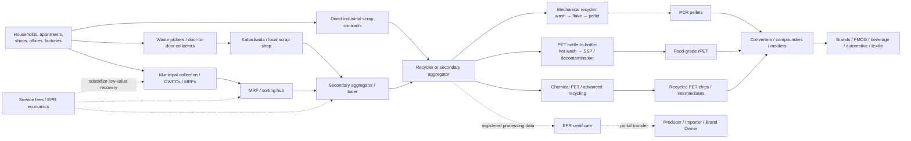

# India’s Plastic Recycling and Waste-Aggregation Market: A 2026 Deep-Dive

## Executive summary

India’s plastic-recycling market is moving from a fragmented, largely informal scrap economy toward a more industrial system in which **feedstock control, traceability, recycled-content quality and EPR compliance are becoming as important as nominal recycling capacity**. The leading companies fall into four distinct groups: industrial recyclers such as Ganesha Ecosphere, Srichakra, Banyan Nation, Lucro, revalyu and Re Sustainability; collection/MRF platforms such as NEPRA and Saahas Zero Waste; digitally enabled aggregators/compliance platforms such as Recykal and ReCircle; and inclusive informal-sector models such as Bengaluru-headquartered Hasiru Dala Innovations. citeturn3view0turn20search3turn22search2turn9search2turn17view0turn16view1

**Feedstock is the strategic bottleneck.** India’s recycling chain still depends heavily on waste pickers, kabadiwalas, neighborhood scrap shops, secondary aggregators and MRFs. The strongest recyclers are therefore vertically integrating upstream rather than merely buying spot scrap. Banyan says it works with more than 10,000 informal collectors; Lucro has developed dozens of collection centers; NEPRA integrates waste pickers with industrial sorting; and Bengaluru-based Hasiru Dala Innovations deliberately buys through waste-picker entrepreneurs, Dry Waste Collection Centres and informal micro-entrepreneurs rather than attempting to disintermediate them. citeturn0search5turn9search9turn1search24turn12search10

**The highest-value recycling segments are increasingly differentiated by polymer and application rather than simply “plastic recycling.”** Srichakra commissioned food-grade bottle-to-bottle PET and deodorized polyolefin capabilities and processed 23,632 tonnes of post-consumer plastic in FY2024-25; Ganesha reports more than 150,000 tonnes of PET waste recycled and 206,940 MTPA of recycling capacity as of March 2026; revalyu commissioned a second Nashik chemical-PET line in late 2024, taking stated site production capacity to 280 tonnes/day; and Lucro has built a specialty position around difficult flexible PE/PP streams. citeturn20search0turn3view0turn15search3turn21view0

**Bengaluru is particularly attractive for a feedstock-first entrant.** It has a mature informal/Dry Waste Collection Centre ecosystem, large institutional and apartment waste generators, and experienced operators such as Saahas Zero Waste and Hasiru Dala Innovations. Saahas currently states that it collects/processes more than 100 tonnes of municipal solid waste per day across 50+ sites, while HDI has spent a decade building an inclusive waste-picker model in the city. Banyan’s current growth profile also reports a 48,000-TPA Bengaluru expansion under development, which is a useful warning: competition for clean PE/PP feedstock in southern India is likely to intensify. citeturn4search2turn12search1turn22search7

**The recycled-resin market is B2B and relationship-driven.** Buyers are packaging converters, compounders, FMCG packaging suppliers, textile/fibre manufacturers, automotive/industrial molders, traders and exporters. Brand owners often qualify the resin and sometimes finance or contract for supply, while the converter actually purchases and runs the pellet. Banyan’s multi-year relationships with Unilever and Reckitt, HUL’s 14.3% strategic investment in Lucro, and the LyondellBasell–Shakti model illustrate how recycled resin is increasingly secured through strategic/offtake relationships rather than purely spot transactions. citeturn0search3turn9search1turn14search1

**There is no transparent national exchange price for PCR pellets or plastic EPR certificates.** A CPCB enforcement record used roughly ₹50–150/kg as a sanity range for recycled-plastic sales when questioning ₹1/kg invoices; this should be treated as a broad cross-grade range, not a current pellet quotation. Current public scrap quotes put mixed plastic around ₹12–14/kg, with sorted single-polymer material commanding substantially more. EPR prices are even less transparent: some 2025 market intermediaries quoted roughly ₹1–1.5/kg for certificate-only transactions, while other 2025-26 compliance vendors quote roughly ₹4–20/kg for broader compliance/credit packages. Those numbers are not directly comparable and should **not** be treated as a statutory or exchange price. citeturn5search12turn24search3turn6search14turn6search16turn6search18

The strongest risk-adjusted entry strategy is therefore **not to begin with commodity recycling capacity alone**. It is to combine a contracted Bengaluru feedstock network with a smaller, technically differentiated mechanical-recycling line—particularly premium rHDPE/rPP/rLDPE—and secure converter/brand qualification before major capex. EPR revenue should be incremental to material economics rather than the sole investment thesis. That conclusion is reinforced by the vertical-integration strategies of Banyan, Lucro, Ganesha and ReCircle and by current regulatory emphasis on physical processing, GST-linked traceability and certificate provenance. citeturn22search7turn21view0turn3view0turn24search1

**Research convention:** figures described by companies as “capacity” are not treated as actual annual throughput. Where annual tonnage or revenue was not found in the reviewed sources, it is marked **unspecified**. Approximate annualizations of daily capacity are explicitly identified as such.

## Competitive landscape and company comparison

The following table deliberately mixes recyclers with large aggregation/MRF platforms because they compete for the same feedstock and EPR relationships. “Tonnage/year” is therefore not perfectly comparable: some figures are recycling output/throughput, others collection or total-waste handling.

| Company | Location | Tonnage/year | Technology / activities | Funding / ownership | Business model | Key customers / partnerships |
|---|---|---:|---|---|---|---|
| **Banyan Nation** | Hyderabad; Bengaluru expansion reported | Current Hyderabad profile reports **10,000 TPA**; 48,000-TPA Bengaluru expansion reported under construction | Mechanical rPE/rPP; washing, color sorting, extrusion/pelletisation; bottle-to-bottle polyolefins; EPR/plastic credits | $0.8m seed in 2016; Series A 2019 and Series B 2023 amounts unspecified; DFC-backed debt/expansion | B2B PCR pellets; EPR/plastic credits; advisory; scrap procurement | Unilever/HUL, Reckitt, Shell; products cited include Surf Excel, Comfort, Harpic and Dettol citeturn22search0turn0search3turn22search7 |
| **Lucro Plastecycle** | Mumbai HQ; Gujarat recycling operations | **>30,000 TPA recycling**, >50,000 TPA collection reported; expansion targets higher | Mechanical LDPE/HDPE/PP; flexible film; de-inking, dry washing, deodorization; pellets plus finished packaging | Circulate Capital 2020 + follow-on 2022; HUL acquired **14.3%** in 2025; amounts unspecified | Collection + pellets + recycled bags/film/packaging; EPR documentation | HUL, Dow; >200 brands reported citeturn9search2turn21view0turn9search1 |
| **Srichakra Polyplast** | Hyderabad / Telangana; acquired Gujarat-based Safar Ecopet in 2025 | **23,632 MT processed FY2024-25**; PET production capacity reached **42,000 TPA** after 2024 expansion | Food-grade mechanical PET-to-PET with SSP; rHDPE/rPP bottle-to-bottle; flakes and pellets; collection/EPR | Circulate Capital investment since 2020; amount unspecified; >$10m invested in 2021 technology/capability | B2B food-grade/packaging resin; collection and EPR solutions | Coca-Cola and PepsiCo circular-packaging use cases cited by investor; global FMCG customers citeturn20search0turn20search11turn21view1turn3view2 |
| **Ganesha Ecosphere** | Kanpur, Uttar Pradesh; multiple plants | **150,000+ MT PET waste recycled**; **206,940 MTPA capacity** FY2026 | Mechanical PET recycling; bottle-grade rPET chips/granules, fibre, filament and spun yarn | Publicly listed; conventional public-equity/debt/capex model rather than VC | B2B recycled raw materials to packaging/textile/industrial customers | **400+ customers**, 300+ resource suppliers citeturn3view0turn3view1 |
| **revalyu Recycling India** | Nashik, Maharashtra; German parent | **280 t/day stated production capacity**, ≈102,200 t/yr annualized nameplate after 2024 expansion | **Chemical PET recycling**; depolymerization/repolymerization; recycled PET chips and yarn | Parent/corporate capital; **$100m investment** announced for expanded Nashik site | B2B rPET chips/yarn; export oriented | >30 global brands; >50% exports reported on company site citeturn15search3turn13search3 |
| **Recykal** | Hyderabad | Annual processing **unspecified**; platform reports **3m+ tonnes cumulative** materials recovered/traded | Digital waste marketplace; EPR platform; DRS; aggregation/traceability; does not principally manufacture pellets | ~$4m 2020 institutional round; **$22m** 2022 round; **₹110cr** 360 ONE investment 2024; **$23m** 2026 bridge including primary/secondary | Marketplace/transaction and service revenue; EPR/DRS; B2B/B2G network | 100+ ULBs, 125+ brands, 150+ recyclers, 500+ aggregators reported in investor material citeturn8search7turn20search10turn10search3turn1search6 |
| **NEPRA / Let’s Recycle** | Ahmedabad | **>500 t/day dry waste**; ≈182,500 t/yr annualized, not disclosed actual annual throughput | MRFs, mechanical sorting, dry-waste aggregation; recyclables to processors; RDF/EOL streams; EPR | Aavishkaar since 2013; **$18m Series C** with Circulate Capital in 2020; BlueEarth minority investment/secondary 2024 | Municipal/corporate contracts + material resale + EPR/compliance | ULBs, PIBOs, corporates, recyclers and co-processors citeturn1search2turn14search12turn1search12 |
| **Saahas Zero Waste** | **Bengaluru** | **100+ t/day** total MSW currently stated; ≈36,500 t/yr annualized | MRFs; 40+ dry-waste categories; composting/biogas for organics; EPR; zero-waste services | **₹6cr** round in 2019 led by C4D with IAN, Lesing-Artha and Asha Impact | Waste-management service fees + recyclables + EPR + consulting; B2B/B2C-community | SBI was first corporate customer; corporates, apartments, campuses and institutions citeturn4search2turn11search3turn11search11 |
| **Hasiru Dala Innovations** | **Bengaluru** | Annual tonnage **unspecified** | Inclusive collection/aggregation; plastics circularity; waste-picker integration; MRF/DWCC linkages | **₹6cr pre-Series A in 2025**, led by Rainmatter and Next Bharat; earlier impact capital incl. Beyond Capital | Service/collection fees, resource sales, circular-plastic projects and brand partnerships | IIM Bangalore; The Body Shop legacy project; institutional clients citeturn12search0turn12search10turn11search9turn12search4 |
| **Shakti Plastic Industries** | Mumbai / Palghar, Maharashtra | Company presentation claims **up to 100,000 TPA** at Palghar; treat as stated capacity | Mechanical recycling of multiple PE/PP/plastic streams; granules; nationwide collection; EPR | Private; funding **unspecified**; 50,000-TPA mechanical-recycling JV/MoU with LyondellBasell | Scrap collection + recycling + pellet sales + EPR services | LyondellBasell; company material claims 350+ corporate relationships citeturn15search19turn14search1 |
| **ReCircle** | Mumbai | Annual throughput **unspecified**; **161,000+ MT cumulative** waste diverted reported by 2025 | Collection, MRFs, traceability/ClimaOne, EPR, plastic credits, recycled-material supply, textile recovery | Pre-Series A 2023 led by Flipkart Ventures, 3i Partners and Acumen; bridge 2024 from Venture Catalysts/Mumbai Angels; amounts unspecified | EPR/program-management fees, waste services, recycled material/plastic-credit programs | HUL, Tata Starbucks, Dabur, Mondelēz, UNDP, Alliance to End Plastic Waste citeturn16view1 |
| **Re Sustainability / Re** | Hyderabad | Plastic: **16,000 MTA stated capacity**, comprising 6,000 existing + 10,000 food-grade under development; group handles ~11m tonnes across waste categories | Advanced mechanical rHDPE/rPP/rLDPE; industrial- and food-grade PCR; broad waste/resource recovery; EPR/carbon platform | **KKR owns 60%** of Re Sustainability | Integrated B2B/B2G environmental services + recycled polymers + resource recovery/EPR | FMCG, packaging, food/beverage and industrial manufacturers; 65,000+ customers across group services citeturn17view0turn17view1 |

**Banyan Nation.** Founded in Hyderabad by **Mani Vajipeyajula, CEO, and Rajkiran Madangopal, COO**, Banyan has built one of India’s strongest premium-polyolefin positions. Its process combines formalized sourcing with washing, multi-stage separation, color sorting, batch blending, extrusion and pelletisation, and its current portfolio includes rPE/rPP, EPR/plastic credits, advisory and recyclability work. The company reports EU REACH, BIS recycled-plastic quality, ISO, GRS and ISCC Plus-related credentials, among others. Its current Unreasonable Group profile reports approximately ₹100 crore revenue, a sold-out 10,000-TPA Hyderabad plant and a 48,000-TPA Bengaluru plant under construction; because these figures are not audited public filings, they should be diligence-checked before investment decisions. citeturn22search1turn0search0turn22search7

**Lucro Plastecycle.** Founded in 2012 and led by co-founder/MD **Ujwal Desai**, Lucro is unusually vertically integrated for flexible plastics: it collects LDPE, HDPE and PP, processes difficult post-consumer films and rigids, produces recycled granules, and consumes part of those granules internally in packaging products. Its facilities use de-inking, cleaning/dry-wash and deodorization steps that are important for meeting brand odor/color specifications. Current company/investor disclosures show 45+ collection centers, a RecyClass-certified recycling facility in Gujarat and quality-management certifications including ISO 9001, 14001 and 45001, GRS/RCS and related standards. HUL’s 2025 acquisition of 14.3% is strategically significant because it gives a major brand owner direct exposure to PCR supply. citeturn9search9turn9search17turn21view0turn9search1

**Srichakra Polyplast.** Founded in 2010, with **Ravindra Venkata** identified as co-founder/CEO in Circulate Capital material and Chandra Sekhar Reddy appearing in the company’s leadership history, Srichakra is one of the most technologically important recyclers in India. It commissioned a Starlinger-based, FDA-accepted-technology food-grade PET line with solid-state polymerization and a deodorized polyolefin bottle-to-bottle facility; the company invested more than $10 million in the 2021 upgrade. It subsequently received a positive EFSA safety assessment, and Circulate says capacity has increased roughly sixfold since its initial 2020 investment. Srichakra reported collecting 26,336 MT and processing 23,632 MT of post-consumer plastic in FY2024-25. citeturn20search2turn21view1turn20search6turn20search0

**Ganesha Ecosphere.** Established in **1987**, Ganesha is the most mature large-scale PET recycler in this comparison. Its FY2026 annual report states 206,940 MTPA total recycling capacity, more than 150,000 MTPA of PET waste recycled, six manufacturing facilities, more than 2,600 employees, 300+ resource suppliers and 400+ customers. Its portfolio spans bottle-grade rPET granules/chips and recycled polyester fibre and yarn, giving it multiple outlets for PET depending on quality. FY2025 revenue was reported at approximately **₹1,466 crore**, with PAT around ₹103 crore, making it fundamentally different in scale and financial maturity from the venture-backed recycling startups. citeturn3view0turn3view1turn2search10

**revalyu Recycling India.** The Nashik operation, formerly associated with the Polygenta business and now part of Germany-based revalyu Resources, is the clearest large commercial example of **chemical PET recycling** in this set. Its process can accept clear and colored/less-pristine PET, chemically break it down and recreate PET chips/yarn. In November 2024 revalyu announced commissioning of its second plant after a **$100 million investment**, bringing the Nashik site to 280 tonnes/day stated production capacity. Earlier site disclosures referred to 15,000 TPA and more than three million bottles/day; the expanded figure supersedes that for current capacity. citeturn13search0turn13search6turn15search3

**Recykal.** Recykal is better understood as digital infrastructure for the recycling market than as a pellet manufacturer. Morgan Stanley describes Rapidue Technologies/Recykal as founded in 2015; founder **Abhay Deshpande** continues to lead the platform. Its marketplace reports more than 10,000 GST-verified businesses, over three million tonnes of material recovered/traded and more than ₹2,500 crore of value generated. Funding has included a roughly $4 million institutional round in 2020, a $22 million Morgan Stanley-led raise in 2022, ₹110 crore from 360 ONE in 2024 and a $23 million bridge transaction in 2026. Entrackr reported FY2026 gross revenue of about **₹1,498 crore** and estimated the post-round valuation at roughly $280 million; that valuation is a media/filings estimate, not a company-announced valuation. citeturn10search2turn8search7turn20search10turn10search3

**NEPRA.** Ahmedabad-based NEPRA, founded in 2011 by **Sandeep Patel, Dhrumin Patel and Ravi Patel**, industrialized the dry-waste/MRF side of the value chain rather than focusing on pellet extrusion. Its model aggregates municipal dry waste, employs/formalizes waste pickers, mechanically sorts saleable fractions and sends residual combustible fractions to appropriate end-of-life/co-processing channels. Investor material places throughput above 500 tonnes/day and total funding above $36 million; its landmark 2020 Series C was $18 million from Aavishkaar and Circulate Capital. BlueEarth Capital subsequently acquired a significant minority position in 2024, providing an exit to one earlier Aavishkaar vehicle while Aavishkaar retained exposure through another fund. citeturn1search24turn1search2turn14search12turn1search12

**Saahas Zero Waste.** The for-profit company was incorporated in **2013** by **Wilma Rodrigues**, building on the earlier Saahas nonprofit. Its significance in Bengaluru is its integrated “waste as a service” model: source segregation, on-site/off-site waste management, MRF sorting, wet-waste composting/biogas, EPR and consulting rather than one polymer-specific recycling technology. It currently reports 100+ tonnes/day collected/processed, 50+ sites and 400+ employees. C4D’s portfolio documentation describes its investment rationale as expanding a hub model around bulk waste generators; this service-fee component is strategically important because it reduces reliance on volatile scrap prices. citeturn11search3turn4search2turn23search2

**Hasiru Dala Innovations.** Founded in **2015** and led by co-founder/CEO **Shekar Prabhakar**, HDI is one of Bengaluru’s most relevant models for an entrant interested in ethically sourced feedstock. Its “Inclusive Circularity” approach deliberately integrates waste pickers. For LDPE milk covers, for example, the company describes a collection chain from waste-picker entrepreneurs, city Dry Waste Collection Centres and informal micro-enterprises into a Bengaluru Plastic Aggregation Centre, where material is sorted and routed to responsible recyclers. A ₹6 crore pre-Series A was announced in 2025 led by Rainmatter and Next Bharat Ventures. Annual tonnage and revenue remain **unspecified** in reviewed primary disclosures. citeturn12search0turn12search10turn11search9

**Shakti Plastic Industries.** Company presentation material describes Shakti as established in **1969** by **Vishwanath Podaar**, with a Palghar recycling facility capable of up to 100,000 tonnes/year, 100+ collection centers, 10,000+ ragpickers and relationships with 350+ companies. Because these are company-marketing figures rather than audited operating data, they should be treated as stated capacity/network metrics. Its strategic relationship with LyondellBasell envisaged a 50,000-tonne/year mechanical recycling operation for post-consumer PE and PP, with Shakti supplying the collection network and LyondellBasell marketing recycled polymers. citeturn15search19turn14search1

**ReCircle.** ReCircle began as RaddiConnect in **2015**, initially linking households/businesses with scrap aggregators, and progressively added MRFs, EPR, recycled-material supply and digital traceability. It reports a network of more than 400 locations and 45 processing partners and more than 161,000 tonnes cumulatively diverted. The company lists Tata Starbucks, Dabur, Mondelēz and HUL among EPR customers and previously worked with UNDP/HUL to scale MRF infrastructure and mobilize more than 1,000 Safai Saathis. Its ClimaOne platform was developed with GSMA Innovation Fund/UK Aid support to digitize traceability across the reverse supply chain. Pre-Series A investors in 2023 included Flipkart Ventures, 3i Partners and Acumen, followed by a 2024 bridge from Venture Catalysts and Mumbai Angels; amounts are **unspecified** in ReCircle’s own history. citeturn16view1

**Re Sustainability.** The former Ramky Enviro platform—now branded Re—is a much broader environmental-infrastructure company than the other recyclers. It reports approximately 11 million tonnes of materials/waste managed across categories, 65,000+ customers and 8,000+ employees, while its dedicated plastics business currently states 16,000 MTA capacity: 6,000 MTA installed plus a 10,000-MTA food-grade line under development in Visakhapatnam. It mechanically produces rHDPE, rPP and rLDPE through cleaning, shredding, washing, extrusion and pelletisation. **Masood Mallick** is current MD and CEO, while KKR owns 60% of Re Sustainability. citeturn17view0turn17view1turn17view2

## Feedstock sourcing and informal-sector economics

India’s real plastic-recycling supply chain is not “household → recycler.” There are usually several economic and physical handoffs, and the material becomes more valuable each time somebody sorts, removes contaminants, accumulates minimum truckload volume or bales it. NITI Aayog’s sustainable urban plastic-waste handbook and a Stockholm Environment Institute study both emphasize the importance of informal collectors and the multiple actors connecting generation to recycling; investor experience in India similarly identifies informal collection/sorting as foundational to high recovery rates. citeturn24search20turn24search17turn20search8

**Waste pickers and kabadiwalas are an asset, not merely a procurement cost.** They perform distributed collection and first-stage separation at a labor cost that a formal fleet often cannot replicate economically. Banyan’s 10,000+ collector network, Lucro’s purchases from manufacturers, retailers, aggregators and waste pickers, and HDI’s explicit integration of waste-picker entrepreneurs all illustrate why leading operators are organizing this network rather than attempting to replace it. citeturn0search5turn20search5turn12search10

A typical urban flow is: a waste picker or household sells PET, HDPE containers and other recognizable high-value items to a local kabadiwala; the kabadiwala segregates by polymer/color, accumulates a few hundred kilograms to tonnes and sells to a larger trader; secondary aggregators bale or grind material and move truckloads to recyclers; MRFs perform a similar concentration function for municipal/bulk-generator waste. Low-value films and multi-layer material are much harder because collection and freight can exceed commodity value; these streams increasingly require an EPR-funded recovery fee, municipal service payment or cross-subsidy from higher-value material. NEPRA, ReCircle, Saahas and HDI all illustrate versions of this hybrid “material value + service/compliance value” model. citeturn1search24turn16view1turn23search2turn12search10

**Public data do not support a single national “kabadiwala margin.”** Current public collection quotations give mixed plastic around **₹12–14/kg**, while sorted, clean single-polymer streams are materially more valuable. Bengaluru waste-sector practitioners also report that plastic prices can change sharply with recycler demand and imported-material availability. Because every stage bears different sorting losses, transport costs and credit periods, gross buy/sell spreads are a better operating concept than a standardized commission. citeturn24search3turn24news28

For financial modeling, rather than claiming these as observed national averages, a new entrant should initially underwrite roughly **8–15% gross buy/sell spread for neighborhood aggregation** and **5–10% for secondary aggregation/baling**, before labor, rent, shrinkage, bad debt and transport, and then replace those assumptions with actual Bengaluru route-level quotes during a three-month procurement pilot. Waste pickers should be modeled as piece-rate suppliers rather than “margin-takers,” while low-value-plastic MRF economics should assume that commodity revenue alone may be insufficient. These are **diligence assumptions, not published market benchmarks**.

Logistics is frequently underestimated. A kilogram of unbaled film occupies far more truck space than a kilogram of rigid HDPE or compacted PET; consequently, baling density, back-haul utilization and distance to recycler often determine whether a stream is economically recoverable. Moisture, food contamination, labels, multilayer structures, incompatible polymer caps/liners, pigments and odor lower yields and can turn apparent low-priced feedstock into expensive net input after washing and rejects. Circulate Capital specifically identifies thin format, contamination, ink, adhesives and multilayer structures as reasons flexible PE is harder to recycle efficiently. citeturn21view0

Seasonality should be modeled in procurement. Consumer-packaging volumes move with festivals and beverage seasons; rain/monsoon periods can increase moisture and dirty-waste handling problems; and the purchase price of scrap changes with virgin polymer prices, recycled-resin demand and imported feedstock. The first two effects vary by city and stream and should be validated locally; the much larger structural point—confirmed by Bengaluru field testimony—is that the informal supplier is exposed to substantial price volatility when recycler uptake changes. citeturn24news28

For Bengaluru specifically, a sensible collection architecture is **not** hundreds of company-owned collection trucks. It is a hub-and-spoke model that contracts existing DWCCs, waste-picker collectives, apartment/bulk-generator collectors and kabadiwalas; provides digital weighing, transparent daily prices and faster payment; installs balers at 5–15 aggregation nodes; and moves full loads to a central wash/recycling plant. HDI’s existing milk-cover model demonstrates that this institutional/informal hybrid already works locally. citeturn12search10

## Recycled pellets, buyers and EPR certificate markets

There are two separate products in this market and they should not be confused: **physical recycled resin** and **EPR compliance certificates**. A recycler may monetize both from the same physical activity, but the buyer, contract, quality requirement and economics are different.

**Physical PCR buyers** fall into several groups. Packaging converters buy rPET, rHDPE, rPP or rLDPE to make bottles, films, caps, containers and industrial packaging. Compounders blend PCR with virgin resin/additives to hit target properties. Automotive and consumer-durable molders can consume darker or performance-modified PP/PE. Fibre/yarn manufacturers take PET flake/chips for textiles. Traders/exporters intermediate smaller loads or arbitrage geography. Major FMCG/beverage brands may not themselves take delivery of pellets, but they qualify the resin, nominate the recycler and require their packaging converter to use it. Banyan, Srichakra, Ganesha, Lucro, revalyu and Re Sustainability collectively cover almost all of these routes. citeturn19search5turn21view1turn3view0turn21view0turn13search3turn17view0

**Public pellet pricing is opaque.** There is no reliable India-wide exchange tape for PCR comparable with exchange-traded commodities, and large brand-qualified contracts are private. CPCB enforcement material has cited roughly **₹50–150/kg** as a plausible recycled-plastic selling-price range while investigating extremely low invoiced prices; that is useful as a fraud-detection/sanity band but is much too broad to constitute a current price for a specific rPET, rHDPE or rPP grade. citeturn5search12

A recycler’s actual quote normally decomposes into feedstock cost, sorting/washing yield, energy and conversion, additives, certification/quality premium, freight and the current virgin-resin reference price. Clear/natural, low-odor PCR with controlled MFI and low contamination commands materially more than mixed-color commodity PCR; food-contact rPET is a separate premium product because it requires decontamination/SSP and food-contact qualification. Srichakra’s >$10 million investment in premium food-grade technology and Lucro’s investment in de-inking/deodorization are practical evidence of the value attached to such quality upgrades. citeturn21view1turn21view0

A procurement team should therefore buy and sell resin by a **technical data sheet**, not simply by polymer name. For PE/PP, contracts commonly need agreed melt-flow rate, density, color, odor, moisture, ash/contamination and mechanical properties. PET needs color, moisture, intrinsic viscosity and—in food-contact use—decontamination and food-safety parameters. Traceability certifications such as GRS/RCS, RecyClass or ISCC Plus can be commercially important for multinational customers, although the exact certification depends on application and market. Banyan and Lucro publicly list multiple such certifications. citeturn0search0turn9search9

The four dominant contract structures are:

| Structure | Typical counterparties | Commercial structure | Main diligence issue |
|---|---|---|---|
| **Spot material** | Traders, smaller converters, compounders | Per-kg quote, one truckload or monthly requirement; short payment cycle; price reset frequently | Variable contamination and no guaranteed demand |
| **Converter supply agreement** | Large packaging/molding converters | Monthly minimum volumes; resin qualification; price formula or periodic reset; quality rejection clauses | Consistency of MFI/color/odor/yield |
| **Brand-backed offtake** | FMCG/beverage brand + nominated converter + recycler | Multi-year or annual volume commitment; strict qualification; audit/traceability; sometimes strategic investment | Long qualification time but highest customer stickiness |
| **EPR compliance contract** | PIBO and registered PWP, often facilitated by an EPR platform | Category/FY-specific processing certificates, periodic transfers, documentation and portal acceptance | Certificate validity, duplicate/fraudulent generation and portal compliance |

Banyan’s multi-year Unilever/Reckitt contracts are an example of the third model; HUL’s strategic stake in Lucro and Circulate-backed companies’ relationships with major brands show the market moving toward supply-security partnerships. citeturn0search3turn9search1turn20search9

### How plastic EPR certificates actually move

Under the CPCB framework, the important legal actor on the supply side is the **registered Plastic Waste Processor (PWP)**. CPCB’s portal guidance provides for PWP registration and generation/transfer of processing certificates to Producers, Importers and Brand Owners. A collector or broker that merely aggregates material does not become entitled to generate recycling certificates simply because it possesses waste; the certificate must be linked to qualifying processing by a registered processor. CPCB guidance also increasingly connects procurement/sales records with GST e-invoices to establish physical and commercial traceability. citeturn24search1turn24search9turn5search9

The commercial transaction therefore typically looks like this: a PIBO calculates its obligation by plastic category and financial year; it or an EPR service provider identifies available certificate inventory from a registered PWP; the parties negotiate commercial price and supporting documentation; the PWP initiates the certificate transfer on the portal; and the PIBO accepts/uses it against its obligation. An intermediary such as Recykal or ReCircle can source and manage the transaction, but the compliance asset ultimately needs valid processor provenance. citeturn24search1turn16view1turn20search5

I found **no government-set trading tariff or floor/ceiling price for plastic EPR certificates** in the reviewed CPCB guidance. Consequently, published market quotes are bilateral and inconsistent. One July 2025 intermediary quoted recycling certificates at roughly **₹1.05–1.50/kg** depending on category, while other 2025-26 compliance vendors cite ranges of roughly **₹4,000–₹20,000 per tonne**, or ₹4–20/kg. These figures may include different certificate categories, end-of-life pathways, service fees, urgency and documentation standards; they should not be blended into a single “market price.” citeturn6search14turn6search16turn6search18

For underwriting, a useful distinction is therefore **certificate-only** versus **managed-compliance** pricing. A certificate-only base case can be stress-tested around low-single-digit rupees/kg, while a physically backed recovery/EPR service for difficult material can cost materially more because it includes collection, segregation, logistics, processing management, audit evidence and provider margin. Every live deal should be rebid quarterly rather than relying on these historic public ranges.

An EPR purchase contract should specify the waste category, financial-year vintage, tonnes/kg, processing route, PWP registration details, timing of portal transfer, GST treatment, supporting procurement/sales evidence, representations against duplicate generation, an indemnity/replacement mechanism if credits are reversed, and payment conditional on successful portal acceptance. This is especially important because enforcement has already focused on mismatches between physical procurement, sales invoices and certificate generation. citeturn15search13turn5search12

## Regulation and compliance

India’s plastic-recycling economics are now closely tied to the **Plastic Waste Management Rules and the EPR regime for plastic packaging**. CPCB’s centralized system registers PIBOs and PWPs and records EPR obligations and certificates; the rules have progressively tightened requirements for recycling, recycled content, traceability and processing documentation. citeturn24search5turn24search1

The most important demand-side structural change is mandatory recycled content. For PET/rigid packaging, industry planning since April 2025 has been based on a 30% recycled-content requirement that rises toward 60% by the end of the decade. This is one reason Circulate Capital argues that the market is shifting from discretionary sustainability procurement to supply-security procurement for high-grade recycled resin. citeturn20search11turn20search9

The technology implication is important: an EPR certificate does **not** by itself make resin suitable for food contact or a multinational packaging line. Food-grade PET requires suitable recycling/decontamination technology and applicable food-contact approvals/standards. Srichakra uses FDA-recognized Starlinger technology and received a positive EFSA assessment; Re Sustainability is separately developing food-grade rHDPE/rPP designed around USFDA/international quality requirements. citeturn21view1turn20search6turn17view0

As of 2026, operators should also avoid hard-coding their software/workflows to the old plastic-only portal. CPCB discontinued the old Plastic EPR portal on **28 June 2026** and migrated data toward the new Common EPR Portal, making flexible API/manual reconciliation and frequent regulatory checks prudent for any new EPR platform. citeturn6search3

Company certifications are useful but should not be confused with statutory authorization. Banyan advertises BIS, ISO, REACH, GRS/ISCC Plus and other certifications; Lucro lists ISO, GRS/RCS, SEDEX and RecyClass-related credentials; Saahas lists ISO 9001, ISO 14001 and ISO 45001 certifications; Srichakra has food-grade technology and EFSA-related validation. These strengthen customer qualification, but an investor still needs to verify each facility’s **live CPCB/SPCB PWP registration, Consent to Establish/Operate and other applicable environmental permissions directly against current records**. citeturn0search0turn9search9turn4search2turn20search6

This distinction is particularly important for aggregators. Recykal, ReCircle, HDI and pure MRF operators can provide collection, traceability, EPR management and material aggregation, but an EPR recycling certificate must originate from eligible registered processing. For an entrant, claiming “we collect X tonnes, therefore we have X tonnes of credits” is an unacceptable compliance assumption. citeturn24search1turn24search9

Shakti’s regulatory history is also a useful diligence lesson rather than merely a negative datapoint. A legal proceeding involving its EPR certificate generation discusses CPCB/MPCB scrutiny of GST e-invoices and processing/sales records. The implication for the whole market is that **traceability is becoming financial infrastructure**: the future winners will be those that can reconcile weighbridge data, supplier KYC, GST documents, production records, pellet sales and certificate balances at batch level. citeturn15search13

## Investor landscape

India now has a meaningful—but still relatively small—capital stack for circular economy businesses. It spans specialist circular-economy private equity, conventional growth equity, impact funds, strategic/corporate investors, family offices and development-finance debt. Circulate Capital is the clearest dedicated specialist: its current application guidance describes roughly **$2–30 million** growth/circular-infrastructure investments and **$1–5 million** early-stage/disruptive-technology tickets. In March 2026 it announced a $220 million first close for Asia Fund II, targeting $300 million, after its first Asia portfolio had added almost 900,000 tonnes/year of collection/recycling capacity. citeturn1search22turn20search9

| Investor / fund | Public ticket information | Stage / focus | Relevant portfolio / deal examples | What appears to matter |
|---|---|---|---|---|
| **Circulate Capital** | **$2–30m** growth; **$1–5m** disruptive-tech guidance | Series A–growth; circular supply chains in South/Southeast Asia | Lucro, Srichakra, Recykal, NEPRA; $9.5m JC Global deal announced 2026 | Scalable circular infrastructure, strong unit economics, measurable material diversion, institutional operations citeturn1search22turn20search9turn1search14 |
| **Aavishkaar Capital** | House ticket range **unspecified** in sources reviewed; NEPRA Series C was $18m with Circulate | Impact/growth capital | NEPRA; first invested 2013 | Financial returns plus inclusion, livelihoods and environmental impact citeturn1search16turn1search2 |
| **BlueEarth Capital** | Typical India cheque **unspecified** | Growth impact/private equity | Significant minority investment in NEPRA in 2024 | Scaled businesses with measurable impact and credible exit path citeturn1search12 |
| **360 ONE Asset** | Observed Recykal investment **₹110cr (~$13m reported)**; house range unspecified | Growth/late-stage private capital | Recykal | Institutional scale, revenue growth and exit potential citeturn10search3 |
| **Morgan Stanley India Infrastructure / IM** | Exact house ticket unspecified; led/participated in **$22m Recykal round** | Growth infrastructure / technology-enabled infrastructure | Recykal | Scalable network/infrastructure business with formalization potential citeturn10search2turn20search10 |
| **C4D Partners** | Individual cheque unspecified; $30.3m first impact fund disclosed | SME growth impact | Saahas Zero Waste | Sustainable livelihoods, gender equity, climate positivity and scalable SME economics citeturn23search6turn23search2 |
| **Rainmatter / Zerodha ecosystem** | Typical investment cheque **unspecified** in reviewed primary material | Early climate/environment | Co-led HDI’s ₹6cr 2025 pre-Series A | Climate action, ecosystem restoration, urban sustainability and livelihoods citeturn23search3turn11search9 |
| **Next Bharat Ventures** | Typical cheque **unspecified** | Early-stage/social-impact businesses | HDI pre-Series A | Scalable businesses tied to livelihood/social outcomes; deal-specific diligence required citeturn11search9 |
| **Acumen / Flipkart Ventures / 3i Partners** | ReCircle round amount **unspecified** | Early/growth; Acumen impact, Flipkart corporate venture | ReCircle 2023 pre-Series A | Traceable scale, technology and impact; strategic adjacency for corporate VC citeturn16view1 |
| **Asha Impact / IAN / Lesing-Artha** | Individual tickets unspecified; participated in **₹6cr Saahas round** | Early/growth impact/angel | Saahas Zero Waste | Mission alignment plus evidence that service-led waste management can scale citeturn11search11 |

The chart below separates **fund-level public ticket guidance** from **specific disclosed transactions/rounds**. A round led by an investor is not the same thing as that investor’s individual cheque, so the dots should not be interpreted as house-wide ticket ranges.

[Download the investor cheque-size chart](sandbox:/mnt/data/india_circular_investor_ticket_sizes.png)

Circulate’s $2–30 million and $1–5 million ranges are fund/strategy guidance. The $22 million Recykal figure is the full Morgan Stanley-led 2022 round; the $18 million NEPRA figure is its Aavishkaar/Circulate Series C; 360 ONE’s Recykal investment was reported around $13 million; and Circulate announced a $9.5 million investment in JC Global in September 2026. citeturn1search22turn20search10turn1search2turn10search3turn1search14

A notable pattern is that **capital becomes easier to raise once three risks have been removed**: secure feedstock, repeatable quality and identified downstream buyers. Circulate’s experience with Lucro and Srichakra illustrates this progression: capital initially built processing quality/capacity, and later strategic brand participation/offtake and partial investor exits demonstrated commercial validation. citeturn20search9turn9search1

For an early entrant, this means a ₹20–50 crore first equity round is unlikely to be won simply by presenting “India produces lots of plastic waste.” Investors will want route-level feedstock evidence, yield data from trial runs, customer qualification letters, PWP/regulatory readiness, gross-margin sensitivity to virgin resin, working-capital requirements, and auditable social/environmental impact. That is an analytical inference from the stated investment criteria and evolution of the funded companies above. citeturn1search22turn23search8turn20search9

## Five ways a new entrant can win

The investment figures below are **indicative 2026 underwriting estimates, not vendor quotations**. They are intended to establish order of magnitude and should be replaced by equipment bids, land/lease quotes and feedstock/offtake term sheets before investment approval. Land purchase is excluded unless noted.

| Winning strategy | Indicative investment | Time to commercial operation | Why it can win | Principal risks and mitigants |
|---|---:|---:|---|---|
| **Build Bengaluru’s feedstock network before the factory** | **₹6–12cr** | **6–9 months** | Create 10–15 micro-aggregation points around DWCCs, kabadiwalas, apartments and commercial generators; provide balers, digital weights, same/next-day payment and transparent daily prices. Feedstock access becomes the moat and can supply own or third-party recyclers. | Informal-network distrust, working-capital leakage, theft/quality variation. Mitigate with existing waste-picker partners, supplier KYC, calibrated digital scales and route-level P&Ls. |
| **Premium polyolefin mechanical recycling** | **₹30–60cr** for ~10–15ktpa | **12–18 months** | Focus on rHDPE/rPP/rLDPE with hot washing, NIR/color sorting, deodorization, filtration and laboratory control. Sell technically qualified resin rather than commodity “recycled granules.” | Virgin-price compression, odor/color rejects, inadequate feedstock. Do not issue final investment approval until ≥60–70% of year-one volume has converter/brand qualification or conditional offtake. |
| **Food-grade rPET bottle-to-bottle** | **₹80–150cr** for ~20–30ktpa | **18–30 months** | Recycled-content mandates make food-grade clear PET strategically scarce; long-term beverage/packaging contracts can create strong customer stickiness. | High capex, clear-bottle competition, food-contact qualification, ramp-up losses. Secure bottle feedstock and anchor converter/bottler agreements first. Srichakra’s >$10m technology investment shows the quality barrier to entry. citeturn21view1 |
| **EPR platform backed by real physical processing** | **₹4–10cr tech/operations + ₹10–30cr working capital** | **6–12 months** | Compete with pure brokers by giving PIBOs batch-level chain-of-custody from collection through PWP processing, GST documentation and certificate transfer. Bundle compliance, material sourcing and recycled-content procurement. | Certificate fraud/reversal, portal changes and commoditized brokerage margins. Own or contract audited PWP capacity; payment only after portal acceptance; maintain replacement/indemnity provisions. citeturn24search1turn15search13 |
| **Bengaluru zero-waste hubs for bulk generators** | **₹8–20cr** for ~20–40 t/day network | **9–15 months** | Sell recurring waste-management contracts to tech parks, apartments, hotels, hospitals and campuses; MRF dry waste, send wet waste to compost/biogas, monetize recyclables and EPR. This copies the most defensible element of the Saahas model: service revenue before commodity resale. | Customer churn, poor source segregation, municipal-interface risk. Use 3–5-year service agreements, contamination fees and localized hubs within short haul radii. citeturn4search2turn23search2 |

**The highest-probability sequence is the first strategy followed by the second.** Spend the first six to nine months proving that 25–40 tonnes/day of segregated PE/PP-rich dry material can be contracted, collected and delivered at a predictable landed cost. During that period, run toll-recycling trials with third-party plants and send sample pellets to at least five converters. Only after achieving stable yields and customer approval should the company commit ₹30–60 crore to its own extrusion/washing facility.

A commercially attractive Bengaluru pilot would therefore begin with **collection rather than chemistry**: secure several DWCC/waste-picker relationships, 20–30 large apartment/office/institutional generators and two or three industrial scrap suppliers; build a 3,000–5,000 tonne/year contracted feedstock book; bale and trade initially; generate a real contamination/yield database; and negotiate one anchor PCR offtake plus one EPR-backed low-value-plastic program. HDI and Saahas demonstrate that the local collection/service layer is already commercially and socially credible, while Banyan’s reported Bengaluru expansion signals future demand for aggregated feedstock. citeturn12search10turn4search2turn22search7

The critical investment KPI is **not tonnes collected** but *contribution margin per tonne after sorting loss, transport and working capital*. A procurement price that looks ₹5/kg cheaper can be worse if moisture/contamination reduces usable yield by 10%, while a more expensive bale with consistent polymer/color can generate higher pellet yield, lower washing cost and fewer customer rejections. This is precisely why Lucro and Banyan have moved toward vertically integrated collection, advanced cleaning/sorting and consistent batch formulation. citeturn21view0turn0search0

The second KPI should be **contracted downstream demand divided by installed capacity**. A new 15,000-TPA plant should not be financed on the assumption that “EPR will create demand.” It should have resin qualification from converters and ideally brand-backed volume commitments before commissioning. India’s strongest recyclers increasingly combine technology with precisely these long-term commercial relationships. citeturn0search3turn9search1turn20search12

Finally, the entrant should view EPR as a **margin enhancer and collection subsidy, not as the fundamental source of economic value**. Certificate prices are opaque, can compress as supply grows, and are exposed to audit/regulatory changes. A plant that is profitable only at unusually high EPR-credit prices is fragile; a plant that makes competitive PCR pellets and uses EPR revenue to finance recovery of harder-to-collect material has a much more durable model. CPCB’s tightening connection between physical processing, GST documentation and certificate generation makes that distinction increasingly consequential. citeturn24search1turn15search13